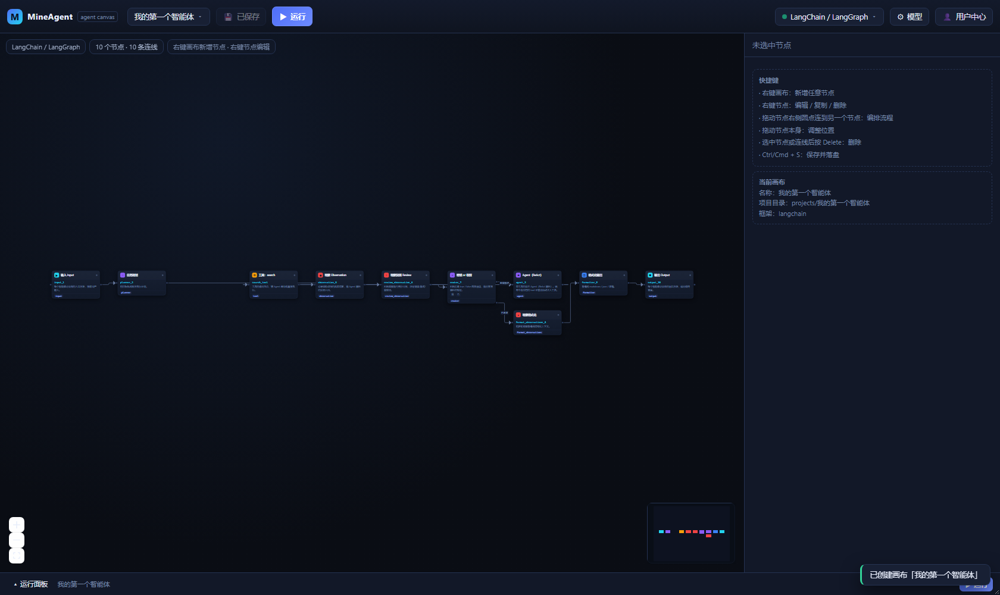
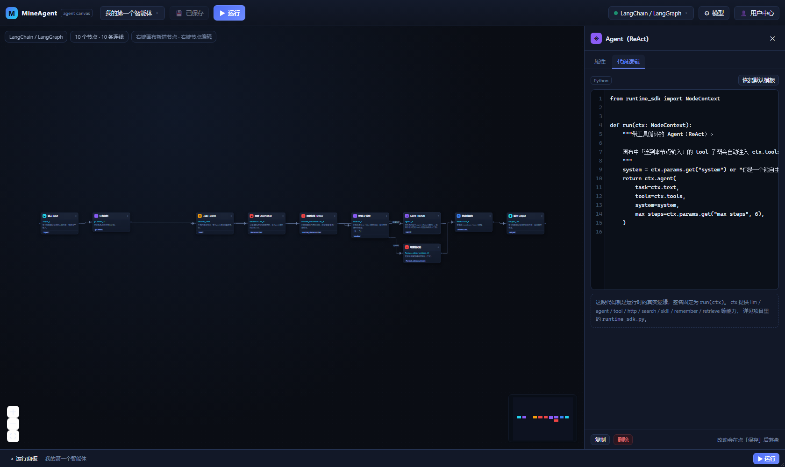
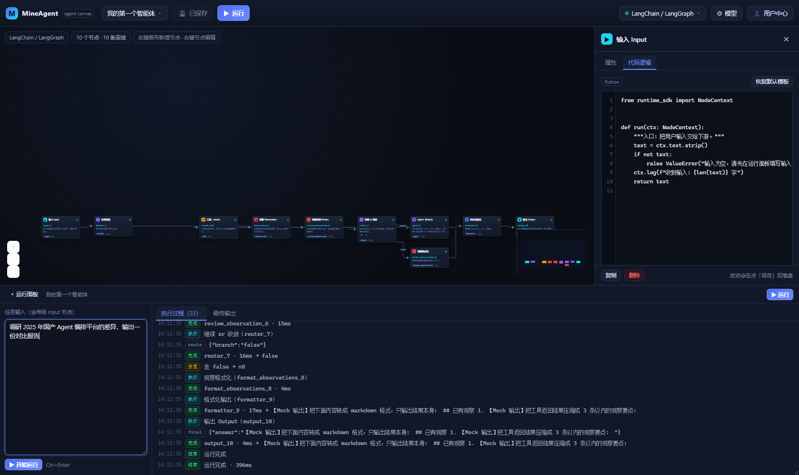
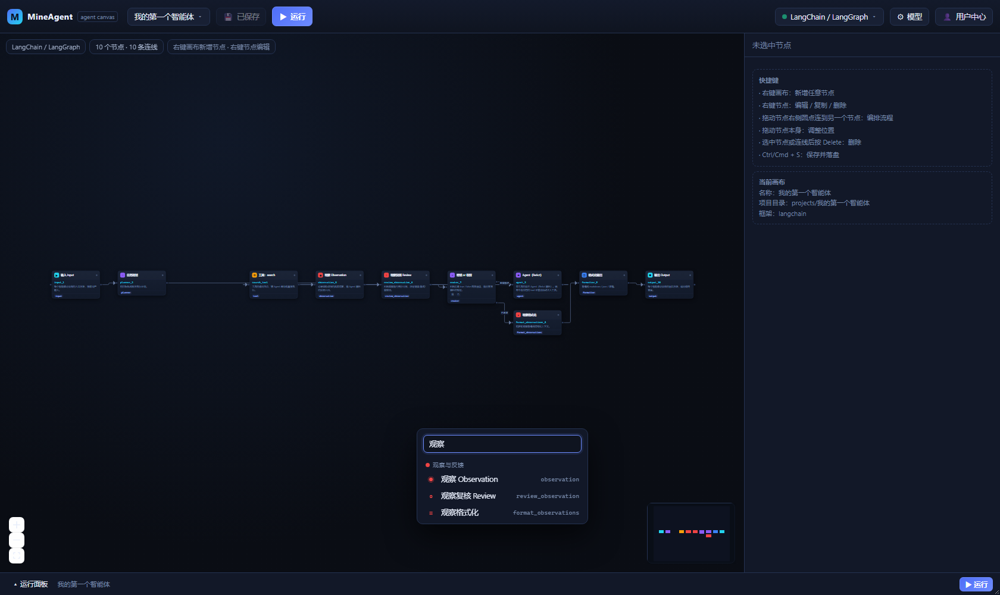
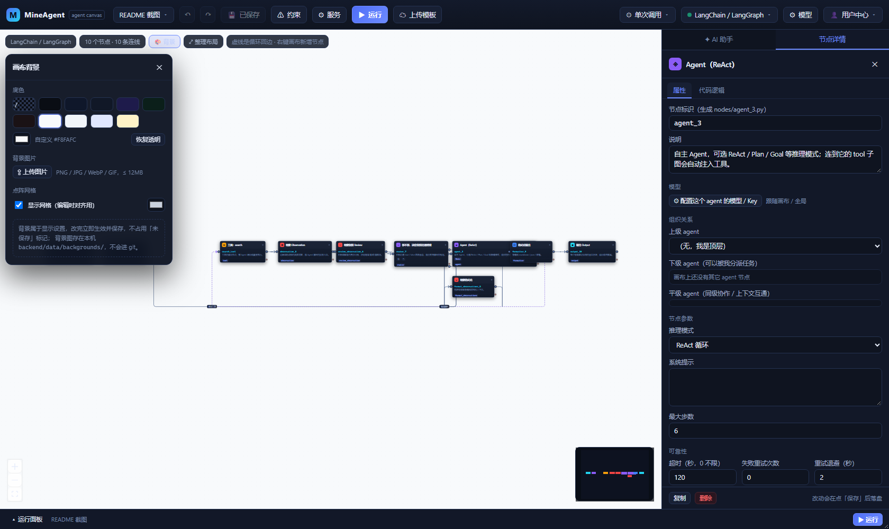
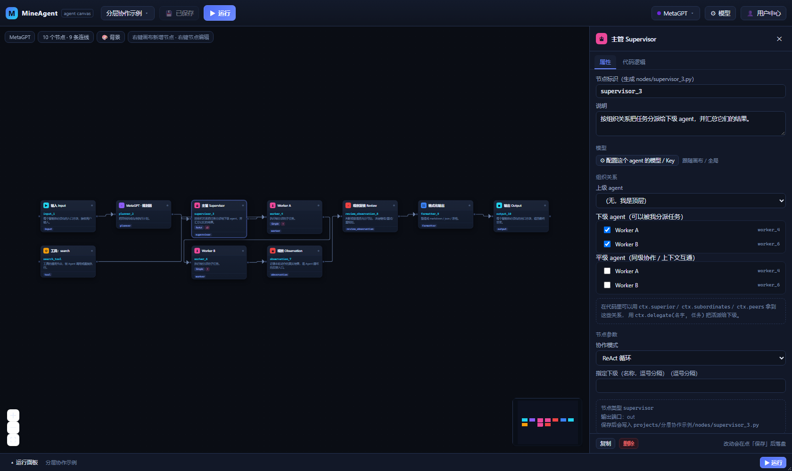

# MineAgent · Agent 编排画布

> Agent 定制自由化，Agent 流程可视化，降低普罗大众使用 Agent 的门槛。

一个本地运行的前后端分离项目：在浏览器里用画布搭出工业级 Agent 流程，选框架自动生成架构图，
拖节点、连线、写代码、配模型，点「保存」就把整张画布编译成**一个可独立运行的 Python Agent 项目**，
点「运行」直接在你的机器上真实执行并流式回传每一步。

- 前端：React 18 + TypeScript + React Flow + Vite
- 后端：Python FastAPI + SQLite（零 ORM、零额外依赖）
- 存储：SQLite 存画布与配置；`projects/<画布名>/` 存生成出来的 Agent 项目
- 启动：双击 `start.bat`（或 `.\start.ps1`），一个端口，一个地址

---

## 快速开始

```powershell
# 方式一：双击 start.bat

# 方式二：命令行
.\start.ps1

# 指定端口 / 开发模式（前端 5173 热更新 + 后端 8000）
.\start.ps1 -Port 8080
.\start.ps1 -Dev
```

脚本会自动完成：Python 虚拟环境 → 后端依赖 → 前端依赖 → 前端构建 → 启动服务 → 打开浏览器。
默认地址 `http://127.0.0.1:8000`，同一局域网内其他设备可用 `http://<你的内网IP>:8000` 访问。

首次启动如果没有任何画布，会自动创建一张 LangChain 架构图。

**没有 API Key 也想跑通？** 另开一个窗口：

```powershell
.\.venv\Scripts\python.exe tools\mock_llm.py --port 8012
```

然后在「用户中心」把 Base URL 填 `http://127.0.0.1:8012/v1`、模型填 `mock-model`、Key 随便填，
整条链路（画布 → 代码 → 运行 → 事件流）就能完整跑起来。

---

## 界面与功能



选中节点后可以编辑属性参数，也可以直接编辑它运行时真正执行的 Python 代码：



点运行后，每个节点的执行过程、耗时、分支走向会实时回显，最终结果单独展示：



右键空白画布可以搜出 67 种节点，从 `observation` 这类经典循环节点到 MCP、向量库、护栏、人工审批：



| 位置 | 功能 |
| --- | --- |
| 左上角下拉 | 切换画布、新增画布（可命名，不填则用默认名）、重命名、删除、打开项目目录 |
| 顶部「保存」 | 把画布落库，并实时生成 `projects/<画布>/` 下的全部代码（`Ctrl/Cmd + S`） |
| 顶部「运行」 | 编译并真实执行当前画布，执行过程流式回显到节点和运行面板 |
| 右上角下拉 | 选择 Agent 框架（LangChain/LangGraph、AutoGen、CrewAI…），切换后重建架构图 |
| 右上角「模型」 | 配置**这个画布**用的大模型与 API Key |
| 右上角「用户中心」 | 配置**整个项目**的全局 API Key（画布没单独配置时回退到这里） |
| 右键空白画布 | 弹出节点面板，67 种工业级节点任选（带搜索） |
| 右键任意节点 | 编辑代码逻辑 / 编辑属性参数 / 重命名标识 / 复制 / 删除 |
| 拖动节点右侧圆点 | 连到下个节点，编排顺序与循环 |
| 拖动节点本身 | 调整位置（吸附 16px 网格） |
| 选中后按 Delete | 删除节点或连线 |
| 双击节点 | 直接打开代码编辑器 |
| 节点属性「推理模式」 | 每个 agent 单独选 ReAct / Plan-and-Execute / Goal / Reflexion / ToolCall / Simple |
| 节点属性「组织关系」 | 指定上级、下级、平级 agent，改一边另一端自动同步 |
| 右键 agent →「配置模型」 | 给单个 agent 配独立模型与 API Key（key 加密入库，不写进项目文件） |
| 画布左上「🎨 背景」 | 底色（含透明）、上传背景图、填充方式与透明度、点阵网格 |

画布支持缩放、平移、框选、MiniMap 导航。每个智能体强制要求一个 `input` 和一个 `output` 方块，
缺少时保存会被拦下并提示。

### 画布背景

画布默认是**透明**的（露出页面底色），也可以换成任意底色，或者上传自己的背景图：



- **底色**：11 个预设色 + 取色器，随时「恢复透明」
- **背景图片**：PNG / JPG / WebP / GIF / BMP，≤ 12MB；四种填充方式（铺满 / 适应 / 平铺 / 居中），
  透明度 5%–100%，可随时移除
- **点阵网格**：可开关、可换颜色，只在编辑时做对齐参考
- 背景是「即改即存」的显示设置，改完立刻生效，不占用「未保存」标记；
  图片存在本机 `backend/data/backgrounds/`，不进 git，删除画布时一并清理

### Agent 推理模式与多 Agent 协作

**推理模式**：每个 agent 类节点（`agent` / `worker` / `supervisor` / AutoGen Tool Agent）
都能在属性面板里单独选推理策略，保存后写进 `agent.json` 的 `params.mode`：

| 模式 | 行为 |
| --- | --- |
| `react` | 思考 → 调工具 → 观察，循环直到能给出答案 |
| `plan_execute` | 先让模型列执行计划，再逐步执行，最后汇总 |
| `goal` | 围绕目标反复推进，每轮自评达成度，未达成就继续 |
| `reflexion` | 先出一版，自我批判后重写，适合对质量要求高的产出 |
| `tool_call` | 只做一轮工具调用，快、便宜 |
| `simple` | 单次推理，不循环不用工具 |

**组织关系**：在 agent 节点的属性面板里指定「上级」「下级」「平级」。
改一边另一边会自动同步——给 A 勾了 B 当上级，B 的下级列表里就会出现 A。
关系只表达组织与调度，不改变画布上的数据连线。



运行时这些关系会注入到节点上下文，代码里可以直接用：

```python
ctx.superior          # 我的上级 agent 名字
ctx.subordinates      # 我的下级 agent 名字列表
ctx.peers             # 平级 agent 名字列表
ctx.delegate("名字", 任务)   # 把活派给某个 agent，等它返回结果
```

`supervisor` 节点的默认模板就是「遍历 `ctx.subordinates` 逐个 delegate，再汇总」，
所以画一张 supervisor + 若干 worker、勾好上下级，就能直接跑出一套分层协作。

**节点级模型**：右键 agent 节点 →「配置模型 / API Key」，可以给这个 agent 单独指定
服务商、Base URL、模型名和 Key。它优先于画布配置，画布配置又优先于用户中心的全局配置。
Key 加密存在本机 `agent_models` 表，运行时通过环境变量 `MINEAGENT_KEY_<节点ID>` 注入子进程，
不会出现在 `agent.json` 或任何项目文件里。

---

## 目录结构

```
MineAgent/
├─ start.ps1 / start.bat        # 一键启动
├─ backend/
│  ├─ app/
│  │  ├─ main.py                # FastAPI 入口 + 前端静态托管
│  │  ├─ config.py              # 路径与端口
│  │  ├─ db.py                  # SQLite（canvases / app_settings / runs）
│  │  ├─ security.py            # key 加密（HMAC 密钥流 + 校验标签）
│  │  ├─ node_registry.py       # 67 种节点类型注册表
│  │  ├─ node_templates.py      # 每种节点的默认代码模板
│  │  ├─ framework_templates.py # 10 个框架 + 各自的架构图模板 + 自动布局
│  │  ├─ codegen/generators.py  # 画布 → 独立 Agent 项目的代码生成
│  │  ├─ runtime/
│  │  │  ├─ runtime_sdk.py      # 节点可用的 ctx 能力（会被复制进每个项目）
│  │  │  └─ runner.py           # 内置图执行器（会被复制进每个项目）
│  │  └─ routers/               # canvases / run / projects / settings / meta
│  ├─ data/                     # mineagent.db、master.key、运行日志、背景图（不入库）
│  └─ requirements.txt
├─ frontend/
│  ├─ src/                      # React 应用
│  ├─ test/ui-smoke.mjs         # headless 浏览器交互测试
│  └─ dist/                     # 构建产物（后端自动托管）
├─ projects/                    # ★ 每个画布一个独立 Agent 项目
├─ tools/
│  ├─ mock_llm.py               # 本地 mock 模型服务
│  ├─ smoke_test.py             # 端到端冒烟测试
│  └─ api_test.py               # 后端边缘场景测试
└─ README.md
```

### 一个生成出来的项目长什么样

以 `projects/竞品调研智能体/` 为例：

```
agent.json          # 画布图定义（节点、连线、参数），保存时自动覆盖
agent.py            # 框架原生入口：LangGraph / AutoGen / CrewAI 真实 API
runner.py           # 内置图执行器，任何画布都能跑（不需要装框架）
runtime_sdk.py      # 节点里 ctx.* 的全部能力
config.json         # 模型配置（不含 key）
.env.example        # 想脱离网页独立运行时，复制成 .env 填 key
nodes/
  input_1.py        # ← 网页里编辑的代码就是这个文件
  planner_2.py
  agent_3.py
  search_tool.py
  observation_5.py
  ...
skills/             # skill.md 技能文件（skill 节点粘贴的内容会落到这里）
outputs/            # 运行产物（artifact_writer 节点写这里）
requirements.txt    # 该框架需要的依赖
README.md           # 这个项目自己的说明
```

单独运行：

```powershell
cd "projects\竞品调研智能体"
python agent.py --input "帮我调研一下国产 Agent 编排平台"
python runner.py --input "..."      # 不依赖框架的执行器
```

---

## 运行原理

1. **保存**：后端把画布 JSON 转成 `agent.json`，为每个节点写出一个 `nodes/<name>.py`，
   再按当前框架生成 `agent.py` 与 `requirements.txt`。删掉的节点对应文件会被清理。
2. **运行**：后端用当前 Python 解释器拉起项目的 `runner.py` 子进程，
   通过 stdout 的 `@@EVENT@@{json}` 行回传事件，再以 SSE 推给浏览器。
3. **执行语义**（`runner.py`）：
   - 从 `input` 节点出发，沿边推进；
   - 多入边节点会先把**还没执行过的上游分支补齐**，再合并输入（fan-in）；
   - 返回 `true` / `false` / `loop` / `exit` 的多端口节点视为**路由节点**：
     走对应出边，且输入原样透传给下游（不改数据），这是循环与分支的基础；
   - 走回边按循环处理，每个节点最多访问 8 次（`agent.json` 里 `max_visits` 可调）。
4. **模型 key 从不落盘到项目目录**：运行时通过 `MINEAGENT_API_KEY` 环境变量注入子进程，
   `config.json` 里只有地址和模型名。

---

## 节点清单（67 种）

| 分类 | 节点 |
| --- | --- |
| 输入输出 | `input` 输入、`output` 输出 |
| 推理与决策 | `llm` LLM 推理、`agent` Agent 主体、`prompt` 提示词模板、`system_prompt` 系统提示词、`planner` 任务规划、`decomposer` 任务分解、`router` 条件路由、`reflector` 反思、`critic` 评审、`self_check` 自检、`evaluator` 质量评估 |
| 工具与能力 | `tool` 工具、`function` 自定义函数、`http_request` HTTP 请求、`web_search` 联网搜索、`code_interpreter` 代码解释器、`shell` 命令执行、`file_io` 文件读写、`sql_query` SQL 查询、`rag_retriever` 知识库检索、`embedding` 向量化、`vector_store` 向量库、`mcp_tool` MCP 工具、`browser` 网页抓取、`skill` 技能 |
| 记忆与状态 | `memory` 记忆、`state_store` 状态存取、`blackboard` 黑板、`history` 会话历史 |
| 流程控制 | `condition` 条件判断、`loop` 循环控制、`join` 分支汇聚、`delay` 延时、`subgraph` 子图调用、`human_approval` 人工审批、`guardrail` 护栏 |
| 观察与反馈 | `observation` 观察、`review_observation` 观察复核、`format_observations` 观察格式化、`error_handler` 错误处理、`retry` 重试、`fallback` 兜底 |
| 多智能体协作 | `supervisor` 主管、`worker` 工作者、`group_chat` 群聊、`handoff` 转交、`debate` 辩论、`message_bus` 消息总线 |
| 后处理与交付 | `formatter` 格式化、`parser` 结构化解析、`summarizer` 摘要、`validator` 结构校验、`artifact_writer` 产物写出、`notification` 通知推送 |
| 框架专有 | `langgraph_state` / `langgraph_node` / `langgraph_edge`、`autogen_assistant` / `autogen_user_proxy` / `autogen_group_chat` / `autogen_tool_agent`、`crewai_agent` / `crewai_task` / `crewai_crew` / `crewai_tool` |

新增节点类型只需要在 `backend/app/node_registry.py` 的 `_DEFS` 里加一行，
并在 `node_templates.py` 里写默认代码，前端菜单会自动出现。

---

## 支持的框架

| 框架 | 状态 | 说明 |
| --- | --- | --- |
| LangChain / LangGraph | ✅ 可运行 | 画布 1:1 映射为 `StateGraph`，条件边对应多端口节点 |
| AutoGen | ✅ 可运行 | 节点映射为 `AssistantAgent` + `RoundRobinGroupChat` |
| CrewAI | ✅ 可运行 | 节点映射为 `Agent` / `Task` / `Crew` |
| MetaGPT、Agno、SmolAgents、Semantic Kernel、OpenAI Agents SDK、Dify Workflow | 🎨 架构图 | 选中后生成对应风格的架构图与代码骨架，暂不接原生执行 |

三个「可运行」框架的项目都会生成 `agent.py` 原生入口；
如果本机没装该框架，`agent.py` 会自动提示并回退到内置 `runner.py`，保证流程任何时候都能跑。

装框架依赖：

```powershell
.\.venv\Scripts\python.exe -m pip install -r "projects\你的画布\requirements.txt"
```

---

## 配置模型

四种方式，优先级从高到低：

1. **节点级**：右键 agent 节点 →「配置模型 / API Key」（只影响这个 agent）；
2. **画布级**：右上角「模型」→ 填 Base URL / 模型名 / API Key（只影响这个画布）；
3. **全局**：右上角「用户中心」→ 配置整个项目默认使用的 key（兜底）；
4. **项目文件**：在 `projects/<画布>/.env` 里写 `MINEAGENT_API_KEY=sk-xxx`（脱离网页独立运行时用）。

填好可点「测试连接」立即验证。Key 加密存在本机 `backend/data/mineagent.db`，
接口只回显 `sk-****abcd` 形式的掩码，不返回明文。
节点级的 key 存在 `agent_models` 表，运行时只以 `MINEAGENT_KEY_<节点ID>` 环境变量的形式注入子进程。

常见服务商的 Base URL 内置在预设里（OpenAI、DeepSeek、通义千问、智谱、月之暗面、Ollama 本地、自定义兼容地址）。

---

## 节点代码能用到什么

每个节点就是 `nodes/<name>.py` 里的一个 `run(ctx)` 函数，`ctx` 提供：

```python
ctx.text / ctx.input        # 上游输出（字符串 / 原始对象）
ctx.state                   # 跨节点共享的可变字典
ctx.params                  # 节点面板里配置的参数
ctx.llm(prompt, system=)    # 调大模型
ctx.llm_stream(...)         # 流式调大模型（token 会实时推到画布）
ctx.agent(task, tools, mode=)  # 内置 agent，mode 可选 react/plan_execute/goal/reflexion/tool_call/simple
ctx.superior                # 我的上级 agent 名字
ctx.subordinates            # 下级 agent 名字列表
ctx.peers                   # 平级 agent 名字列表
ctx.delegate(名字, 任务)     # 把任务派给某个 agent 并取回结果
ctx.json_prompt(...)        # 结构化输出
ctx.http(...) / ctx.search() / ctx.fetch_text() / ctx.mcp_call(...)
ctx.skill(name, inline)     # 读 skills/*.md 或直接用内联的 skill.md 内容
ctx.remember() / ctx.recall() / ctx.history()
ctx.retrieve() / ctx.embed() / ctx.vector_upsert() / ctx.vector_search()
ctx.exec_python() / ctx.shell() / ctx.read_file() / ctx.write_file() / ctx.query_sql()
ctx.log() / ctx.emit() / ctx.route()
```

`skill` 节点既可以直接把整份 `skill.md` 粘进代码，也可以在参数里填文件名，
再用 `ctx.skill()` 读取 `skills/` 下的文件。

---

## 测试

```powershell
# 后端 + 代码生成 + 真实执行（需要 mock 或真 key）
.\.venv\Scripts\python.exe tools\smoke_test.py

# 框架切换 / 改名 / 删除 / 文件浏览
.\.venv\Scripts\python.exe tools\api_test.py

# 浏览器端交互（右键菜单、代码编辑、保存、运行）
cd frontend
node test/ui-smoke.mjs
```

---

## 常见问题

**端口被占用**：`.\start.ps1 -Port 8080`。

**前端改了代码没生效**：`.\start.ps1 -Rebuild`，或 `cd frontend; npm run build`。

**中文在脚本里显示乱码**：`start.ps1` 已存为 UTF-8 with BOM；如果被编辑器改存成别的编码，
用 PowerShell 7 运行，或重新执行 `.\start.ps1 -NoBrowser` 检查提示信息。

**运行报「缺少模型 API Key」**：按上面「配置模型」任选一种方式配置。

**模型返回 401/404**：检查 Base URL 是否带 `/v1`（如 `https://api.deepseek.com/v1`），
以及模型名是否与服务商一致。

**想彻底重来**：删掉 `backend/data/` 和 `projects/` 下的内容，重新启动即可
（会生成新的加密主密钥，已保存的 key 需要重填）。

**网页上改了代码，但项目目录里被我手改过**：以画布为准——点保存会覆盖 `nodes/*.py`。
建议始终在网页里编辑节点代码，或者改完不要再到网页点保存。
