# MineAgent · Agent 编排画布

> Agent 定制自由化，Agent 流程可视化，降低普罗大众使用 Agent 的门槛。

一个本地运行的前后端分离项目：在浏览器里用画布搭出工业级 Agent 流程，选框架自动生成架构图，
拖节点、连线、写代码、配模型，点「保存」就把整张画布编译成**一个可独立运行的 Python Agent 项目**，
点「运行」直接在你的机器上真实执行并流式回传每一步。

- 前端：React 18 + TypeScript + React Flow + Vite
- 后端：Python FastAPI + SQLite（零 ORM、零额外依赖）
- 存储：SQLite 存画布与配置；`projects/<画布名>/` 存生成出来的 Agent 项目
- 启动：双击 `start.bat`（或 `.\start.ps1`），一个端口，一个地址

> 想看每个版本改了什么，见 [CHANGELOG.md](CHANGELOG.md)。

---

## 快速开始

```powershell
# 方式一：双击 start.bat

# 方式二：命令行
.\start.ps1

# 指定端口 / 开发模式（前端 5173 热更新 + 后端 8000）
.\start.ps1 -Port 8080
.\start.ps1 -Dev
```

脚本会自动完成：Python 虚拟环境 → 后端依赖 → 前端依赖 → 前端构建 → 启动服务 → 打开浏览器。
默认地址 `http://127.0.0.1:8000`，同一局域网内其他设备可用 `http://<你的内网IP>:8000` 访问。

首次启动如果没有任何画布，会自动创建一张 LangChain 架构图。

**没有 API Key 也想跑通？** 另开一个窗口：

```powershell
.\.venv\Scripts\python.exe tools\mock_llm.py --port 8012
```

然后在「用户中心 → 模型配置」把 Base URL 填 `http://127.0.0.1:8012/v1`、模型填 `mock-model`、Key 随便填，
整条链路（画布 → 代码 → 运行 → 事件流）就能完整跑起来。

---

## 界面与功能

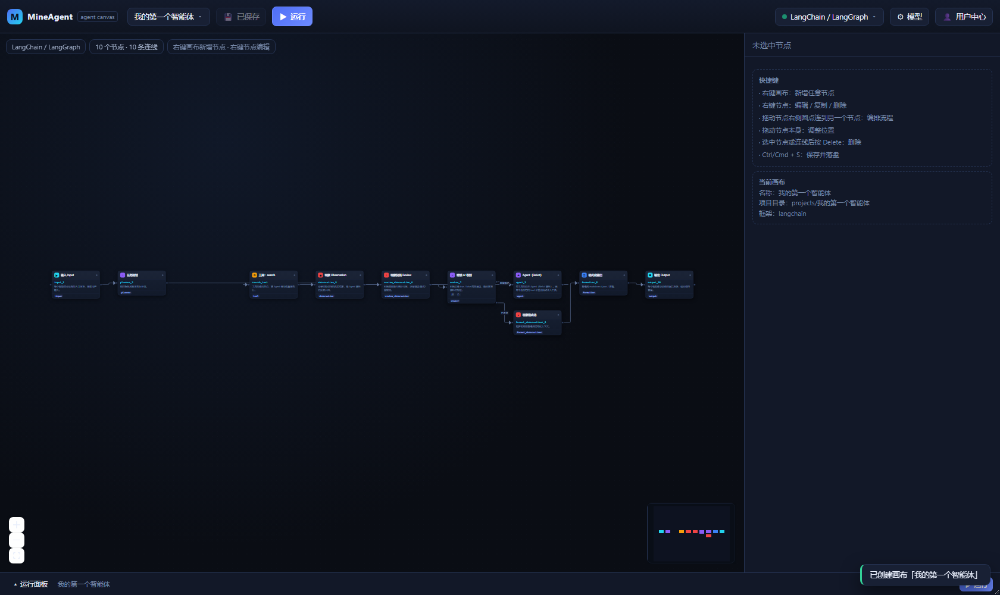

选中节点后可以编辑属性参数，也可以直接编辑它运行时真正执行的 Python 代码：

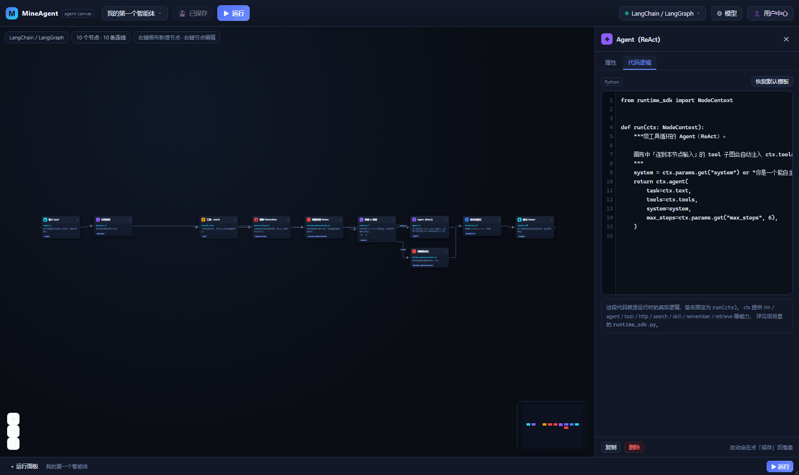

点运行后，执行到哪个节点，哪个节点就会实时高亮（脉冲边框 +「运行中」角标）；
运行面板逐条打印「执行到哪个节点、耗时多少、输出什么」，模型输出逐 token 流式回显，
最终结果单独展示：

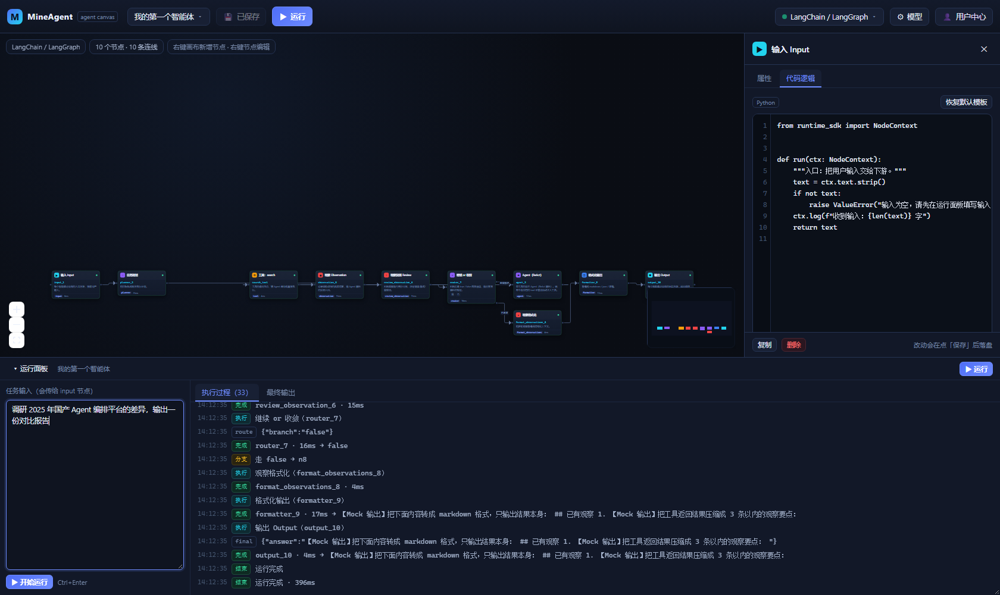

右键空白画布可以搜出 113 种节点，从 `observation` 这类经典循环节点，到意图识别、查询改写、混合检索、重排、上下文拼装，再到 MCP、护栏、人工审批：

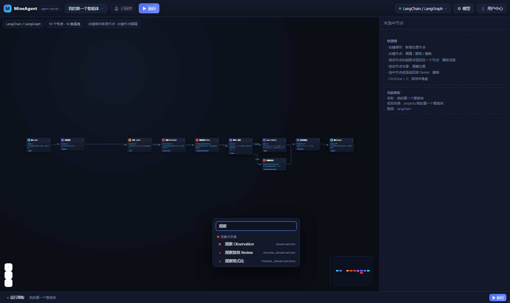

| 位置 | 功能 |
| --- | --- |
| 左上角下拉 | 切换画布、新增画布（可命名，不填则用默认名）、重命名、删除、打开项目目录 |
| 顶部「保存」 | 把画布落库，并实时生成 `projects/<画布>/` 下的全部代码（`Ctrl/Cmd + S`） |
| 顶部「↶ / ↷」 | 撤销 / 重做画布改动（`Ctrl+Z` / `Ctrl+Shift+Z` 或 `Ctrl+Y`），连续拖动合并成一步 |
| 顶部「⚠ 约束」 | 编排约束面板：内置规则 + 自定义规则，违规节点在画布上标红 |
| 顶部「⚙ 服务」 | 画布级服务设置：入口 / 会话并发 / 可观测 / 安全；保存后编译进生成项目的服务文件 |
| 顶部「运行」 | 编译并真实执行当前画布，执行过程流式回显到节点和运行面板 || 右上角「选择模式」 | 框架**左边**的下拉，列出该框架支持的推理模式（ReAct / CoT / Plan-and-Execute / 群聊…），选中后作为画布默认，新建 agent 节点会用它 |
| 右上角下拉 | 选择 Agent 框架（LangChain/LangGraph、AutoGen、CrewAI…），切换后重建架构图 |
| 右上角「画布配置」 | 这张画布自己的对话模型、向量模型、向量库与数据源 |
| 右上角「用户中心」 | 账户与配置下拉：GitHub 账户 / 模型配置 / 公共模板 |
| 运行按钮右侧「☁ 上传模板」 | 把当前画布和项目文件贡献成社区模板，自动创建 GitHub PR（不含任何密钥） |
| 右键空白画布 | 弹出节点面板，113 种细粒度节点任选（带搜索）；新增后**按约束自动连线** |
| 鼠标划过节点面板条目 | 右侧弹出该节点的「概念 / 解释 / 用途 / 编码建议」 |
| 右键任意节点 | 编辑代码逻辑 / 编辑属性参数 / 重命名标识 / 复制 / 删除 |
| 拖动节点右侧圆点 | 连到下个节点，编排顺序与循环（靠近目标节点会自动吸附，不用精确对准小圆点） |
| 右键节点「连线到其它节点」 | 不拖拽也能连线：先选节点，多端口节点再选出口，最后选目标 |
| 拖动节点本身 | 调整位置（吸附 16px 网格） |
| 选中后按 Delete | 删除节点或连线 |
| 悬停节点 | 浮层显示「概念 / 解释 / 用途 / 编码建议」四段说明，而不是干巴巴的字段 |
| 右键空白画布 | 弹出节点面板，113 种细粒度节点任选（带搜索）；**鼠标划过条目也会显示同一份说明** |
| 单击节点 | 只选中（用于连线和缩放），**不会**切换右侧面板 |
| 右键任意节点 | 打开右侧「节点详情」并弹出操作菜单 |
| 双击节点 | 直接打开代码编辑器 |
| 右侧「AI 助手」 | 常驻对话面板，用「用户中心 → 模型配置」的 key 解答框架 / 编排问题 |
| 节点属性「推理模式」 | 每个 agent 单独选 ReAct / Plan-and-Execute / Goal / Reflexion / ToolCall / Simple |
| 节点属性「组织关系」 | 指定上级、下级、平级 agent，改一边另一端自动同步 |
| 右键 agent →「配置模型」 | 给单个 agent 配独立模型与 API Key（key 加密入库，不写进项目文件） |
| 画布左上「🎨 背景」 | 底色（含透明）、上传背景图、填充方式与透明度、点阵网格 |
| 画布左上「⤢ 整理布局」 | 按上下游重新排布：输入最左、输出最右，分层排列、互不重叠、连线不交叉 |

画布支持缩放、平移、框选、MiniMap 导航。每个智能体强制要求一个 `input` 和一个 `output` 方块，
缺少时保存会被拦下并提示。

连线的几个细节：

- **连线会自动绕开节点**：直连被挡住时，自动改走节点群上方、下方或右侧，
  不会压在节点上，也不会被节点盖住；拖动节点后连线会实时重新绕行
- **同一对节点之间的多条边会自动上下错开**，不会叠成一条看不清
- **循环回边用虚线**（紫灰色），和正向流程线区分开；从右往左绕回去的边会被自动识别
- 分支标签（是 / 否 / 循环）渲染成小圆角 chip，跟着走线走
- **点击一条线，两端节点会一起高亮**，方便确认这条线是从哪连到哪
- **右键一条线**可以「修改起点 / 修改终点 / 重置弯曲 / 删除」，改成非法端点会被拦下
- **按住线中间的小圆点拖动**，可以调整这根线的弯曲走向；连接关系（source / target）不变
- 「⤢ 整理布局」按上下游重新排布，具体是：
  - **输入固定在最左、输出固定在最右**，中间按 BFS 分层从左到右铺开
  - 同层节点纵向排列并居中，层内按"上游重心的平均位置"排序，减少连线交叉
  - 层间距和行间距**按最宽/最高的节点自适应**（不小于 340 / 140），
    保证节点不重叠、线上分支名放得下
  - 排完自动 fitView

**新增节点会自动连线**，不用每次手动接：

| 情况 | 行为 |
| --- | --- |
| 先选中某个节点，再右键空白处新增 | 从选中节点连过来，并把原来那条边拆开——新节点**插到两者中间** |
| 没有选中节点时新增 | 连到**距离最近**的可接上游节点 |
| 新增的是工具类节点（tool / MCP / 检索…） | 优先挂到最近的 **agent 下游** |
| 新增的是 output | 接到当前**末端节点** |
| 新增的是 input，或附近找不到合法上游 | **不连线**，保持孤立（避免凭空造出违规） |

自动连线全程遵守约束：output 不会被当成上游、input 不会被当成下游、
不会重复连同一对节点。多端口节点（router 等）会优先选用还没占用的出口。

### 画布背景

画布默认是**纸白**色（`#f8fafc`），配浅灰点阵网格；也可以换成任意底色，或者上传自己的背景图：

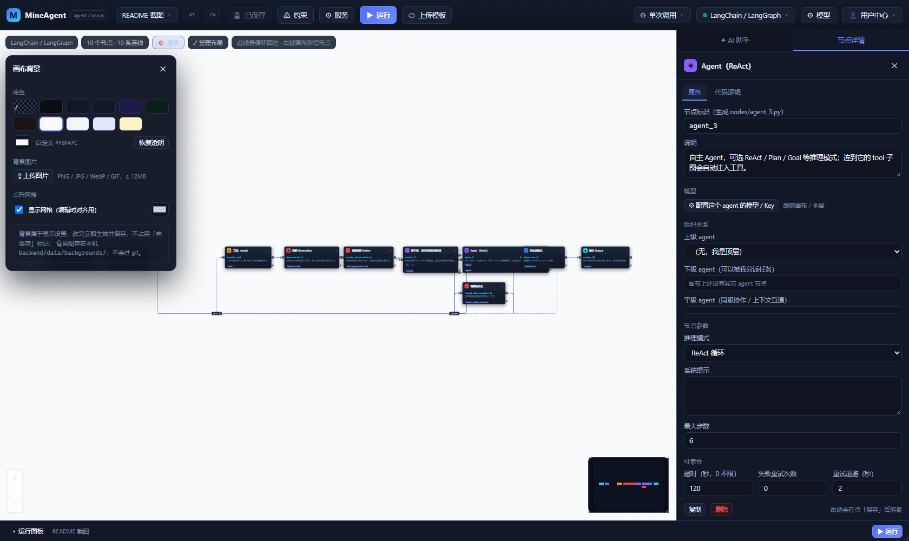

- **底色**：11 个预设色 + 取色器，随时「恢复透明」
- **背景图片**：PNG / JPG / WebP / GIF / BMP，≤ 12MB；四种填充方式（铺满 / 适应 / 平铺 / 居中），
  透明度 5%–100%，可随时移除
- **点阵网格**：可开关、可换颜色，只在编辑时做对齐参考
- 背景是「即改即存」的显示设置，改完立刻生效，不占用「未保存」标记；
  图片存在本机 `backend/data/backgrounds/`，不进 git，删除画布时一并清理

### Agent 推理模式与多 Agent 协作

**推理模式**：每个 agent 类节点（`agent` / `worker` / `supervisor` / AutoGen Tool Agent）
都能在属性面板里单独选推理策略，保存后写进 `agent.json` 的 `params.mode`：

| 模式 | 行为 |
| --- | --- |
| `react` | 思考 → 调工具 → 观察，循环直到能给出答案 |
| `plan_execute` | 先让模型列执行计划，再逐步执行，最后汇总 |
| `goal` | 围绕目标反复推进，每轮自评达成度，未达成就继续 |
| `reflexion` | 先出一版，自我批判后重写，适合对质量要求高的产出 |
| `tool_call` | 只做一轮工具调用，快、便宜 |
| `simple` | 单次推理，不循环不用工具 |

**组织关系**：在 agent 节点的属性面板里指定「上级」「下级」「平级」。
改一边另一边会自动同步——给 A 勾了 B 当上级，B 的下级列表里就会出现 A。
关系只表达组织与调度，不改变画布上的数据连线。

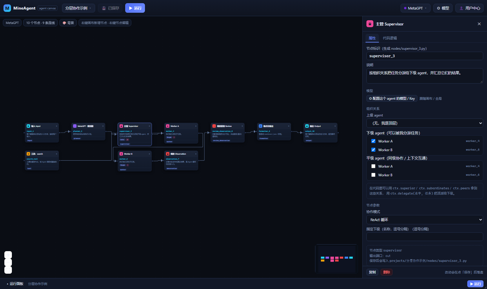

运行时这些关系会注入到节点上下文，代码里可以直接用：

```python
ctx.superior          # 我的上级 agent 名字
ctx.subordinates      # 我的下级 agent 名字列表
ctx.peers             # 平级 agent 名字列表
ctx.delegate("名字", 任务)   # 把活派给某个 agent，等它返回结果
```

`supervisor` 节点的默认模板就是「遍历 `ctx.subordinates` 逐个 delegate，再汇总」，
所以画一张 supervisor + 若干 worker、勾好上下级，就能直接跑出一套分层协作。

**节点级模型**：右键 agent 节点 →「配置模型 / API Key」，可以给这个 agent 单独指定
服务商、Base URL、模型名和 Key。它优先于画布配置，画布配置又优先于「模型配置」里的全局配置。
Key 加密存在本机 `agent_models` 表，运行时通过环境变量 `MINEAGENT_KEY_<节点ID>` 注入子进程，
不会出现在 `agent.json` 或任何项目文件里。

**节点可靠性**：每个节点的属性面板里还有一组「可靠性」开关——超时、失败重试次数、
重试退避、每分钟调用上限、失败策略、执行沙箱、工具调用幂等。

它们不是画布上的节点，而是节点属性：重试、超时、限流都是「怎么跑」的执行约束，
做成节点会诱导你把控制流当业务流。生成代码里由统一的 `_track` 包装执行：
超时用线程超时、只对网络/限流/超时类错误重试、超过每分钟上限就等待。

**错误出口**：每个节点右下角有一个红色小端口，拖出来的边是红色虚线「错误」边。
节点失败时，接了错误边走错误分支继续跑，没接才中断整条流程；
失败策略选「走 error 连线」后，原生模式会生成 `conditional_edges` 做分流。

### 社区模板（GitHub 分享）

画布可以像配置文件一样分享：把自己的作品提 PR 到社区仓库，别人在应用里一键加载成新画布。
入口都在右上角「用户中心」下拉里：

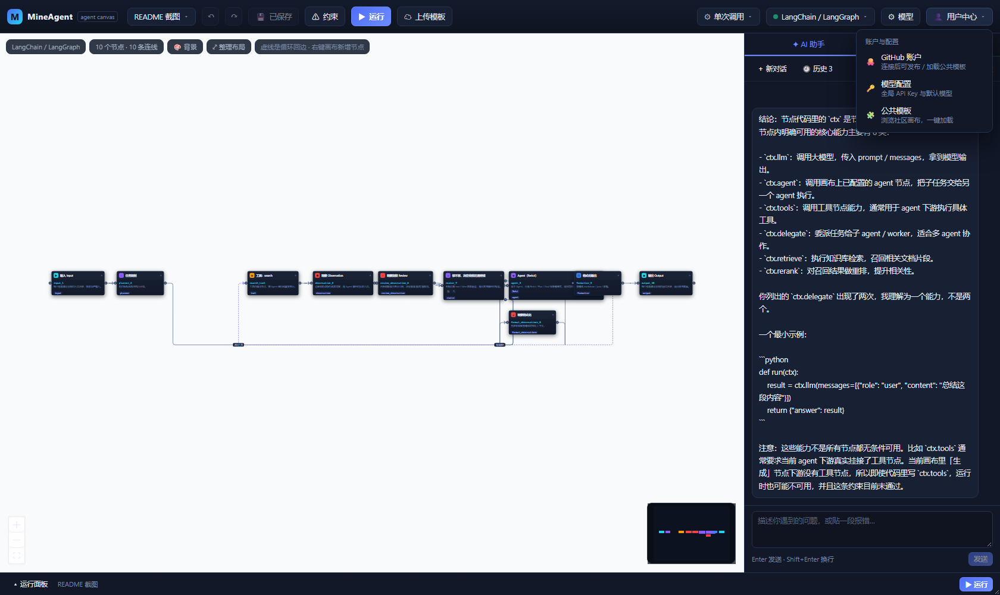

**上传自己的模板**：点运行按钮右侧的「☁ 上传模板」，填名称、描述、标签和署名。
提交后后端会调 GitHub API 自动 fork / 建分支 / 提交文件 / 创建 Pull Request，
由仓库维护者审批合并。

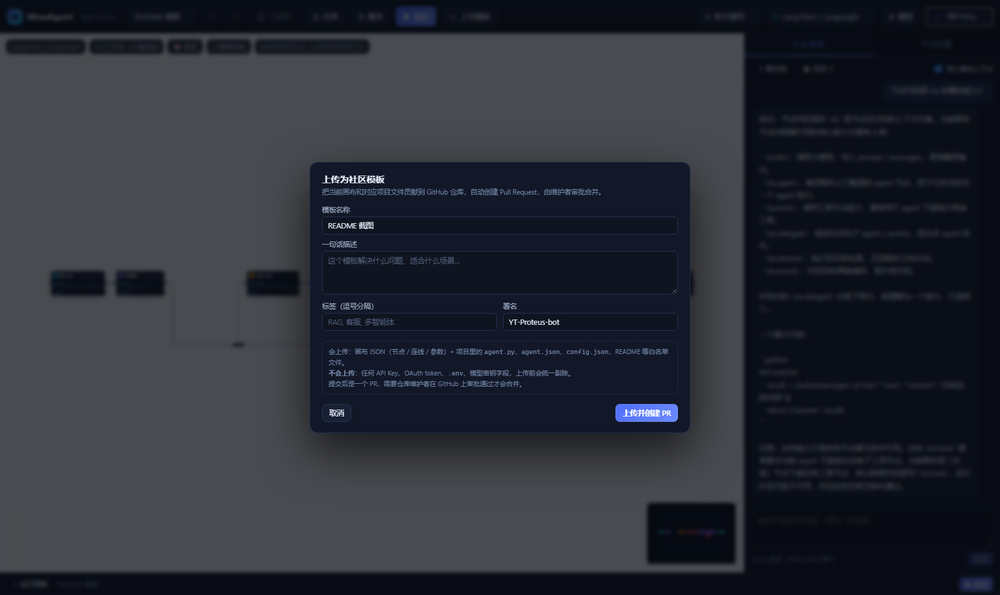

**加载别人的模板**：用户中心 →「公共模板」，列表来自社区仓库的 `templates/` 目录，
点「加载」会自动新建一张画布，把节点、连线、参数和代码一起下载进来。

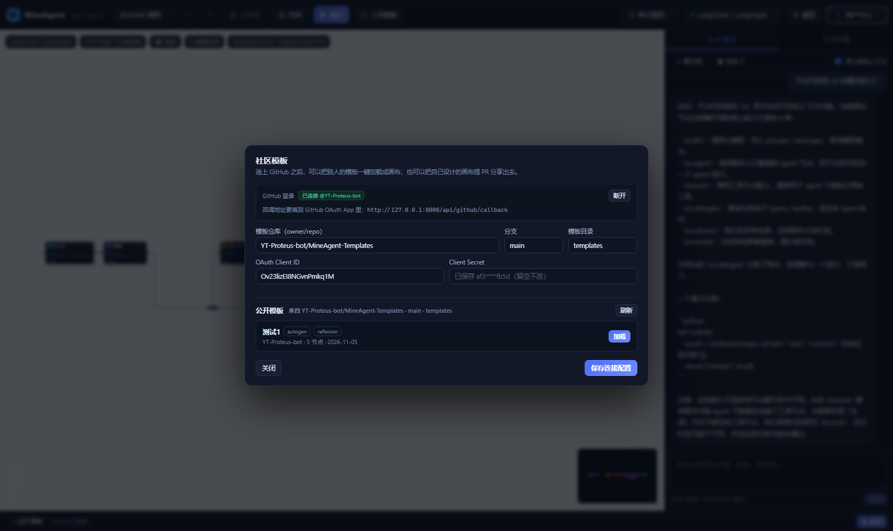

**连接 GitHub**：用户中心 →「GitHub 账户」，填模板仓库 `owner/repo` 和 OAuth App 的
Client ID / Secret，点「连接 GitHub」跳转网页授权（`public_repo` + `read:user`），
回调后 token 加密存在本机。OAuth App 的 Authorization callback URL 要填
`http://127.0.0.1:8000/api/github/callback`（页面里会显示当前地址）。

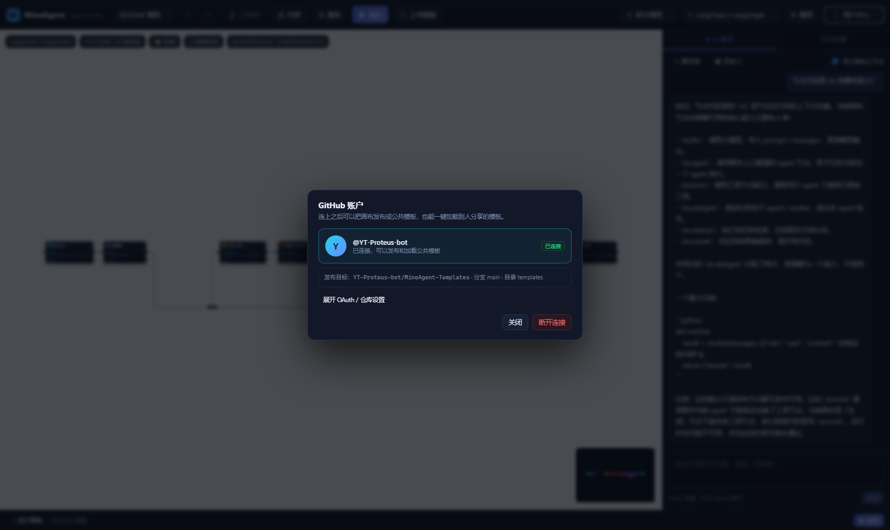

上传内容与安全：

- 会上传：`templates/<slug>/meta.json`、脱敏后的 `canvas.json`，以及 `project/` 下的白名单文件
  （`agent.py`、`agent.json`、`config.json`、README、requirements、run 脚本、skills）
- **不会上传**：任何 API Key、`api_key_cipher`、OAuth token、`.env`、本机背景图路径；
  发布前统一递归剔除，`config.json` 的 `api_key_env` 会重置为 `MINEAGENT_API_KEY`
- 模板仓库需要是**公开仓库**（申请的是 `public_repo` 权限），第一次上传前先初始化一个 README

### 内置 AI 助手（Agent）

右侧那一列有两个 tab：「AI 助手」（默认）和「节点详情」。

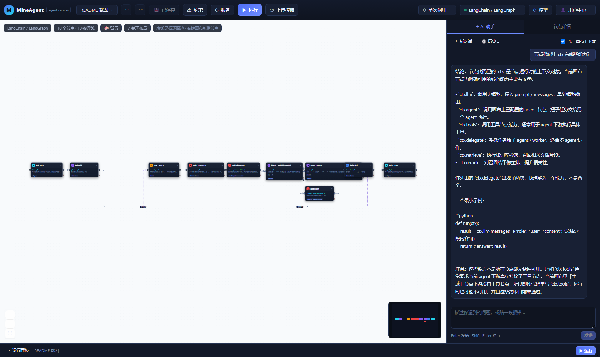

它是一个**能调用工具的 Agent**，不只是聊天：

- 用的是**你在「用户中心 → 模型配置」里配的 key**
- 流式输出，可随时停止；「＋ 新对话」开一轮新的
- **每张画布有独立的对话和记忆**，切画布不会串上下文

**工具集**

| 读工具（自动执行） | 作用 |
|---|---|
| `get_canvas` | 读当前画布的真实节点 id、类型、参数、连线 |
| `get_config` | 读框架 / 推理模式 / 对话模型 / 服务设置 / 已配的向量与数据源（**不含密钥**） |
| `get_node_doc` | 查某类节点的用途、参数、默认代码 |
| `list_node_types` | 列出可用节点类型（可按关键词过滤） |
| `get_run_log` | 读最近一次运行的执行过程（每个节点的开始/结束/耗时/输出/报错） |
| `get_constraints` | 读编排约束检查结果 |
| `recall` | 按关键词查这张画布的长期记忆 |
| `list_architectures` | 列出已收录的开源智能体架构指纹 |
| `get_architecture` | 读某个智能体的行为特征、节点拓扑与推荐框架/模式 |
| `scan_source` | 扫描源码库（GitHub / 本地目录 / 上传的压缩包）拿架构线索 |

| 写工具（**要你确认**） | 作用 |
|---|---|
| `apply_ops` | 增量改画布：增删节点、改参数/代码、连线、挪位置 |
| `apply_canvas` | 整张替换成新画布 |
| `update_service` | 改服务设置（入口 / 会话 / 并发 / 可观测 / 安全），按字段深合并 |
| `update_model` | 改对话模型（provider / base_url / model / 参数），**不动 Key** |
| `set_mode` | 切默认推理模式 |
| `switch_framework` | 切 Agent 框架（**会重建架构图**，二次确认） |
| `upsert_provider` | 新建向量模型 / 向量库 / 数据源（只写非密钥字段） |
| `apply_architecture` | 按架构指纹整张生成画布（同时把框架与推理模式切过去） |
| `run_canvas` | 运行画布（会消耗模型额度） |

写工具**不会直接执行**，只在对话里生成一张待确认卡片，你点「应用」才落地。
`switch_framework` 这种破坏性操作会在卡片和二次确认里都标明「会重建架构图」。

**密钥边界**：AI 读不到也写不了 API Key。`get_config` 只返回 `has_key: true/false`；
新建向量库/数据源后，它会提醒你去「画布配置」里补 Key。

**记忆与压缩**

- **短期记忆**：会话内的最近 20 轮消息，随对话保存
- **长期记忆**：按画布存（`remember` 工具写入），跨会话生效；
  用户表达偏好、确认非显然结论时它会主动记；内容近重复会去重更新
- **上下文压缩**：对话超过 30 条时，把较早的内容压成一段摘要（保留目标、约束、
  已确认结论、待办），只保留最近 10 条；摘要随对话一起存，刷新后仍然有效

**它可以直接改画布**，两种方式：

| 你说的话 | 它给出的 | 卡片按钮 |
|---|---|---|
| 「帮我搭一个带检索的客服 Agent」「重新设计成多智能体」 | 一整张新画布 | **应用到当前画布**（整张替换，会先确认） |
| 「加一个检索节点」「把那个工具接到助理下面」「改一下这个节点的代码」「把节点往右挪」 | 一组增量操作 | **应用这些修改**（只改动的部分） |

没配 key 时面板会提示去「用户中心 → 模型配置」，不会静默失败。

### 还原开源智能体的架构

内置一份**架构指纹库**，收录了 16 个主流智能体。每个指纹包含三样东西：

- `behaviors`：这个项目区别于别家的关键行为（可验证，不是形容词）
- `nodes` / `edges`：等价的画布拓扑
- `codes`：让行为真的对上的节点代码（比如 AutoGPT 的任务队列出队）

| 项目 | 框架 | 模式 | 核心范式 |
| --- | --- | --- | --- |
| AutoGPT | langchain | goal | 目标拆任务队列，逐任务执行并反思 |
| BabyAGI | langchain | goal | 任务队列 + **每轮重排序** |
| MetaGPT | metagpt | sop | SOP 流水线，产物驱动 |
| CrewAI | crewai | sequential | 角色协作，各角色独立上下文 |
| CAMEL | langchain | two_agent | 双向角色扮演，自判终止 |
| Voyager | langchain | code_agent | 技能库累积 + 自动课程 |
| OpenHands | langchain | code_agent | 沙箱内 act-observe 循环 |
| AutoGen | autogen | group_chat | 共享历史 + 动态选人发言 |
| ChatDev | crewai | sequential | 软件公司四阶段流水线 |
| LangGraph | langchain | react | 显式状态图 + 条件边 + checkpoint |
| DeepSeek Harness | harness | react | 插件化 runtime，闸门 + 分层压缩 + 持久化 |
| Dify / n8n | dify / langchain | workflow | 变量驱动的节点工作流 |
| Coze | langchain | chatflow | Bot = 人设 + 插件 + 知识库 |
| Flowise / Langflow | langchain | rag | 可视化 RAG / 组件链 |

说「还原 AutoGPT」时，助手会 `get_architecture` 拿指纹、再 `apply_architecture` 生成画布，
**同时把顶部「框架」和「模式」两个下拉框切到对应值**。

**没收录的项目它会直说「还没收录」，不会假装还原。**

### 从源码画出架构

三种输入都能进：

| 方式 | 怎么用 |
| --- | --- |
| GitHub 地址 | 直接说仓库链接；私有仓库需要在「用户中心 → 社区模板」连过 GitHub 且授权了 `repo` |
| 上传源码包 | 助手面板点「📦 源码」，选 `.zip` / `.tar.gz` / `.tgz` / `.tar` |
| 本地目录 | 直接给路径（会拒绝系统目录） |

源码进来后先做**静态扫描**（`backend/app/source_scan.py`），不做执行：

- 目录结构、语言分布、入口文件
- 依赖声明：`requirements.txt` / `pyproject.toml` / `package.json` / `go.mod`
- 每个模块的 import 关系、类（含体量）、函数名——Python 走 `ast`，JS/TS 走正则
- prompt 片段、工具定义线索（`@tool` / `StructuredTool` / `"type": "function"`）

扫描结果交给模型归纳成节点图。**核心目录优先**（`src`/`apps`/`packages`/`core`…），
`scripts`/`build`/`docs` 靠后，避免工具脚本把扫描名额占满。

限制：单文件 ≤ 200KB，最多扫 1500 个文件；JS/TS 的函数内容看不到，只有 import 和类名。

### 编排约束

画布不是随便连的。顶部「⚠ 约束」会跑一整套规则，违规节点在画布上标红并带 ⚠ 角标：

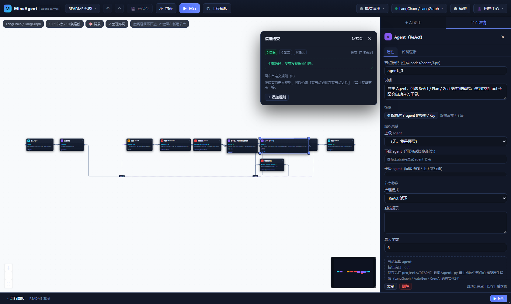

**内置规则（18 条）**，分三类：

| 类别 | 规则 |
| --- | --- |
| 结构 | 有且只有一个输入节点、至少一个输出、输入不能有入边、输出不能有出边、无孤立节点、所有节点都能从输入到达、都能通向输出、不能自环、多入边需能合并 |
| 语义 | 分支节点两条出边都要连、循环节点必须有退出出口、有环就要有循环控制、工具节点应挂在 agent 下游、用工具的 agent 要连到 tool、技能节点必须有内容、命令执行前建议加护栏 |
| 数量 | 单画布节点数不超过 200 |

级别分三档：`error` 会**拦住运行**，`warn` 只提示，`info` 纯告知。

**自定义规则**（跟着画布保存）支持四种：

- **顺序约束**：某节点必须在某节点之后 / 之前
- **必须包含**：画布必须出现某类节点
- **禁止出现**：不允许出现某类节点
- **数量上限**：某类节点最多几个

每条可以选「拦截」或「提示」。内置规则是回边感知的——循环里 router 指回 agent 的那条边
不会被误判成「多入边」。

三个触发点：

1. 编辑时：停止操作 1.3 秒后自动复查，违规节点实时标红；
2. 保存时：照常保存（不耽误编辑中间态），但会把报告一并返回并提示还有几条没满足；
3. 运行时：`error` 级直接拦下并打开约束面板指出差在哪；确实要跑可以强制放行。


---

### 服务设置（画布级契约）

顶部「⚙ 服务」把整张画布当成一个后端服务来配置，**不改变流程图本身**：

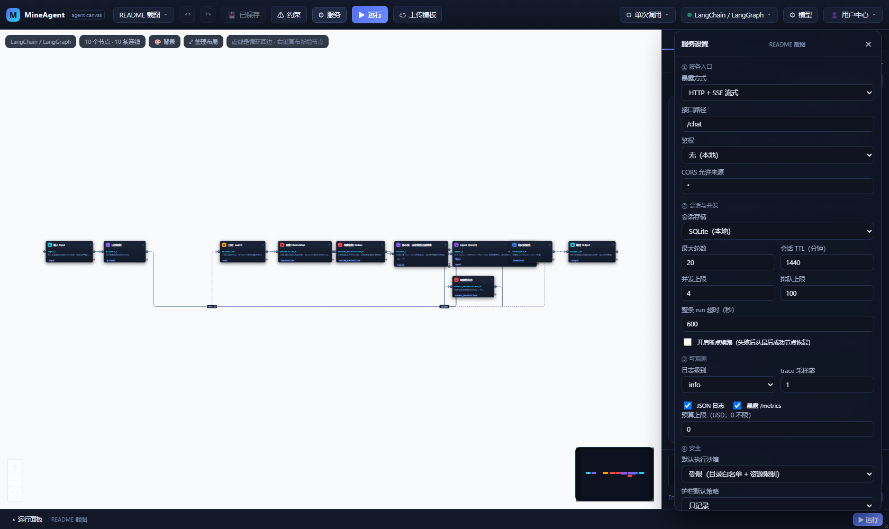

| 组 | 配什么 |
| --- | --- |
| ① 服务入口 | 暴露方式（HTTP / SSE / 两者）、接口路径、鉴权（无 / API Key / OIDC）、CORS |
| ② 会话与并发 | 会话存储（无 / SQLite / Postgres）、最大轮数、会话 TTL、并发上限、排队上限、整条 run 超时、断点续跑 |
| ③ 可观测 | 日志级别、JSON 日志、`/metrics` 开关、trace 采样率、预算上限 |
| ④ 安全 | 默认执行沙箱、护栏默认策略、PII 脱敏、审计 |

保存后配置写进画布的 `graph.service`，并编译进生成项目：

- `settings.py` 按它生成默认值，运行时全部可以用环境变量覆盖；
- `server.py` 按它生成 `/chat`、`/chat/stream`、`/health`、`/ready`、`/metrics` 和鉴权；
- `checkpoint.py` 按「会话存储」选择 SQLite / Postgres 的 checkpointer；
- `telemetry.py` 按「可观测」决定 JSON 日志与 metrics。

**会话存储**解决的是「多轮对话能不能接着上一轮」：一次运行结束后状态默认只在内存里，
存下来之后，同一个 `thread_id` 的下次请求会从上次的状态继续。它和 `memory` 节点不是一回事——
前者是运行时层的「存档读档」，后者是 Agent 逻辑层的「日记本」。

一句话：**流程图表达「做什么」，服务设置表达「怎么跑、怎么上线」。**

## 目录结构

```
MineAgent/
├─ start.ps1 / start.bat        # 一键启动
├─ backend/
│  ├─ app/
│  │  ├─ main.py                # FastAPI 入口 + 前端静态托管
│  │  ├─ config.py              # 路径与端口
│  │  ├─ db.py                  # SQLite（canvases / app_settings / runs）
│  │  ├─ security.py            # key 加密（HMAC 密钥流 + 校验标签）
│  │  ├─ node_registry.py       # 113 种节点类型注册表
│  │  ├─ node_templates.py      # 每种节点的默认代码模板（预览用 run(ctx)）
│  │  ├─ node_templates_ext.py  # 扩展节点模板（意图识别 / 意图路由 / Wiki 等）
│  │  ├─ node_docs.py           # 节点悬停说明（概念 / 解释 / 用途 / 编码建议）
│  │  ├─ tool_presets.py        # 工具节点的预设实现
│  │  ├─ framework_templates.py # 10 个框架 + 各自的架构图模板 + 自动布局
│  │  ├─ framework_modes.py     # 各框架支持的推理 / 协作模式（33 个）
│  │  ├─ mode_templates.py      # 每个模式一套节点模板（选中直接生成画布）
│  │  ├─ constraints.py         # 编排约束规则库
│  │  ├─ community.py           # 社区模板：脱敏打包 + GitHub API
│  │  ├─ codegen/
│  │  │  ├─ native.py           # ★ 画布 → agent.py 的框架原生代码生成
│  │  │  ├─ generators.py       # 项目骨架、requirements、文件落盘
│  │  │  └─ production.py       # 服务设置 → server.py / Dockerfile / CI 等生产化文件
│  │  ├─ providers/             # ★ 向量模型 / 向量库 / 数据源的适配层
│  │  │  ├─ catalog*.py         #   枚举清单（纯数据，加一家只改这里）
│  │  │  ├─ embedding.py        #   6 类 embedding 协议
│  │  │  ├─ vectorstore.py      #   14 个向量库适配器
│  │  │  ├─ datastore.py        #   6 类数据库协议
│  │  │  └─ bindings.py         #   画布/全局配置解析、密钥环境变量
│  │  ├─ runtime/
│  │  │  ├─ runtime_sdk.py      # 节点可用的 ctx 能力（会被复制进每个项目）
│  │  │  └─ runner.py           # 内置图执行器（会被复制进每个项目）
│  │  └─ routers/               # canvases / run / projects / settings / providers / meta / community
│  ├─ data/                     # mineagent.db、master.key、运行日志、背景图（不入库）
│  └─ requirements.txt
├─ frontend/
│  ├─ src/                      # React 应用
│  ├─ test/                     # headless 浏览器交互测试
│  └─ dist/                     # 构建产物（后端自动托管）
├─ projects/                    # ★ 每个画布一个独立 Agent 项目
├─ tools/
│  ├─ mock_llm.py               # 本地 mock 模型服务
│  ├─ build_framework_blueprints.py  # 生成 14 张编排架构画布
│  ├─ regen_and_run.py          # 批量重新生成 + 实跑验证
│  ├─ smoke_test.py             # 端到端冒烟测试
│  └─ api_test.py               # 后端边缘场景测试
├─ CHANGELOG.md                 # 版本更新记录
└─ README.md
```

### 一个生成出来的项目长什么样

**`projects/` 下的每个文件夹都是一个完整的、可独立部署的 Agent 后端项目**：
把自己那个文件夹整个拷走就能跑，不依赖 MineAgent 平台，也不依赖数据库。

```
agent.py            # ← 核心：这一整张画布的框架原生代码
server.py           # FastAPI 服务入口：/chat、/chat/stream、/health、/ready、/metrics
settings.py         # 服务配置（环境变量驱动，默认值来自画布的「服务设置」）
telemetry.py        # 结构化日志 + 轻量 metrics
checkpoint.py       # 会话持久化（SQLite / Postgres 的 LangGraph checkpointer）
Dockerfile          # 容器镜像
docker-compose.yml  # 一条命令起服务
.github/workflows/ci.yml   # 编译 + 冒烟测试
tests/              # pytest 冒烟测试（不需要真实模型）
agent.json          # 画布图定义（节点、连线、参数、节点代码）
runner.py           # 零依赖预览执行器（不装框架也能在这里跑一遍）
runtime_sdk.py      # runner 用的运行时（只用标准库）
providers/          # 向量模型 / 向量库 / 数据源适配层（和平台同一个实现）
run.ps1 / run.sh    # 一键运行
config.json         # 模型配置 + 向量与数据源配置（不含 key）
.env.example        # 脱离网页独立运行时，复制成 .env 填 key
skills/             # skill.md 技能文件
outputs/            # 运行产物
requirements.txt    # 该框架需要的依赖（含服务化依赖）
```

**没有 `nodes/` 目录**。每个节点不是单独一个 `.py` 文件，而是 `agent.py` 里一个带
`═══` 标记的代码块——打开 `agent.py` 看到的就是这个 Agent 的完整实现：

```python
# ═══════════════════════════════════════════════════════════════
# 节点：Agent（ReAct）  (agent_3)  类型：agent
# ═══════════════════════════════════════════════════════════════

def agent_3(state: AgentState) -> dict:
    """Agent（ReAct） —— 推理模式：react，最多 6 步。"""
    agent = create_agent(
        model=llm,
        tools=TOOLS,
        system_prompt="你是一个能调用工具的智能体……",
    )
    result = agent.invoke(
        {"messages": [{"role": "user", "content": state.get("data", "")}]},
        config={"recursion_limit": 14},
    )
    messages = result.get("messages") or []
    answer = str(getattr(messages[-1], "content", "")) if messages else ""
    return {"data": answer}
```

**网页上节点的「代码逻辑」显示的就是这一段**——改那里，保存后 `agent.py` 里同一段跟着改。
在画布上右键新增的节点，一创建出来就是这种原生块，不是保存后才变。

不同类型节点对应不同的原生写法：

| 节点类型 | `agent.py` 里的写法 |
| --- | --- |
| `tool` / `web_search` | `@tool def xxx(query: str)`，自动汇总进 `TOOLS` |
| `agent` | `create_agent(model=llm, tools=TOOLS, system_prompt=...)` + `invoke` |
| `planner` / `observation` / `formatter` | `ChatPromptTemplate` + `llm.invoke(...)` |
| `router` | 返回 `{"route": "true"/"false"}`，图里接 `add_conditional_edges` |
| `retriever` | `vectorstore.as_retriever(...)` 的骨架代码 |
| `memory` | 简单的对话历史窗口 |
| `input` / `output` | 图的首尾函数 |

图本身用 **LangGraph 的 `StateGraph`** 组装：`builder.add_node(...)`、
`builder.add_edge(...)`、`add_conditional_edges(...)`、`builder.compile()`——
和你手写一个 LangGraph 项目没有区别。

`tool` 节点不会作为图里的一步：它的边会被"穿透"（`agent → tool → observation`
在代码里变成 `agent → observation`），工具函数由 agent 内部调用，这才是 ReAct 的正常用法。

### 代码和画布怎么保持同步

保存时会做这几件事，是**真正的增量修改**而不是每次推倒重写：

- **新增节点** → `agent.py` 里多一个带 `═══` 标记的函数块，图里多一行 `add_node` / `add_edge`
- **删除节点** → 对应的代码块和图里的 `add_node` / `add_edge` 一起被移除
- **改节点参数** → 只重新生成那一个块
- **手动改过代码** → 该节点标记为「已手改」，之后保存**保留你的版本**，不会被覆盖；
  点「恢复默认模板」可以丢弃手改重新生成
- 生成完会把每个块**写回画布数据**，所以网页上看到的就是 `agent.py` 里的真实代码

### 运行时跑的是真代码

点「运行」时：

1. 检查这张画布对应框架的依赖（`langchain` / `langchain-openai` / `langgraph`）是否就绪
2. **就绪 → 直接执行项目里的 `agent.py`**，跑的就是你在文件里看到的代码
3. 缺失 → 自动降级到零依赖的 `runner.py` 预览，运行面板上会标明「零依赖预览」

运行面板会显示当前是「真实运行 agent.py」还是「零依赖预览」。

AutoGen / CrewAI 两个框架同理：会生成 `AssistantAgent` + `GroupChat`、
`Agent` + `Task` + `Crew` 的原生写法。

自包含这块做了几件具体的事：

- `runtime_sdk.py` 与 `runner.py` 都复制进项目目录，只用 Python 标准库，
  **只要机器上有 Python 3.9+ 就能零依赖预览运行**，不需要 pip 装任何东西
- 执行器设置了 `sys.dont_write_bytecode`，跑完目录里不会冒 `__pycache__`
- 每次保存都会清掉残留的 `__pycache__`，目录始终是可直接打包的状态
- `skills/`、`outputs/` 带 `.gitkeep`，进 git 或压缩后目录结构不会丢

单独运行：

```powershell
cd "projects\竞品调研智能体"

# ① 零依赖预览：不装任何框架，用 runner 按图跑一遍
.\run.ps1 "帮我调研一下国产 Agent 编排平台"

# ② 真正跑原生代码：先装框架依赖，再走 agent.py
.\run.ps1 -Install
.\run.ps1 -UseFramework "帮我调研一下国产 Agent 编排平台"

# 或者手动
python agent.py --input "..."
```

实测：把整个目录拷到别的路径、用系统 Python（不带本项目的 .venv）执行
`run.ps1`，可以直接跑通。

### 运行附件（文件 / 图片）

运行面板的任务输入支持三种方式带上附件：

- **选文件**：点「📎 添加文件」
- **拖入**：把文件直接拖到输入框区域
- **粘贴**：在输入框里 Ctrl+V 粘贴剪贴板中的图片

文件存到项目目录的 `inputs/` 下（单个 ≤ 20MB），运行时路径清单会拼进 input：

```
你的任务描述

[附件]
- inputs/report.pdf
- inputs/chart.png
```

同时通过环境变量 `MINEAGENT_INPUT_FILES` 传给子进程，节点里可以用 `ctx.files` 拿到相对路径列表，
再配合 `ctx.read_file(path)` 读取；`doc_loader` / `pdf_parser` / `ocr_extract` 这些节点直接填路径即可。

附件是画布级的，切走再回来还在；画布删除时跟着项目目录一起清理。

---

## 运行原理

1. **保存**：后端把画布 JSON 转成 `agent.json`，再按当前框架把整张图生成为一份
   `agent.py`（每个节点是里面一个带 `═══` 标记的函数块），同时写出 `requirements.txt`。
   删掉的节点对应代码块会被清理。
2. **运行**：依赖齐全时直接执行 `agent.py`（框架原生代码）；依赖缺失或想零安装预览时，
   后端拉起项目的 `runner.py` 子进程按图执行。两条路径都通过 stdout 的
   `@@EVENT@@{json}` 行回传事件，再以 SSE 推给浏览器。
3. **执行语义**（`runner.py`）：
   - 从 `input` 节点出发，沿边推进；
   - 多入边节点会先把**还没执行过的上游分支补齐**，再合并输入（fan-in）；
   - 返回 `true` / `false` / `loop` / `exit` 的多端口节点视为**路由节点**：
     走对应出边，且输入原样透传给下游（不改数据），这是循环与分支的基础；
   - 节点失败时，如果接了红色「错误出口」边就走错误分支继续，否则中断整条 run；
   - 每个节点执行前后都会回传 `node_start` / `node_end`（含耗时、输出、重试次数），
     模型输出逐 token 回传 `token` 事件，运行面板据此实时高亮与滚动；
   - 走回边按循环处理，每个节点最多访问 8 次（`agent.json` 里 `max_visits` 可调）。
4. **模型 key 从不落盘到项目目录**：运行时通过 `MINEAGENT_API_KEY` 环境变量注入子进程，
   `config.json` 里只有地址和模型名。
5. **保存时按「服务设置」生成生产化文件**：`server.py` / `settings.py` / `telemetry.py` /
   `checkpoint.py` / Dockerfile / compose / CI / tests，全部随项目一起走。

---

## 节点清单（113 种，13 类）

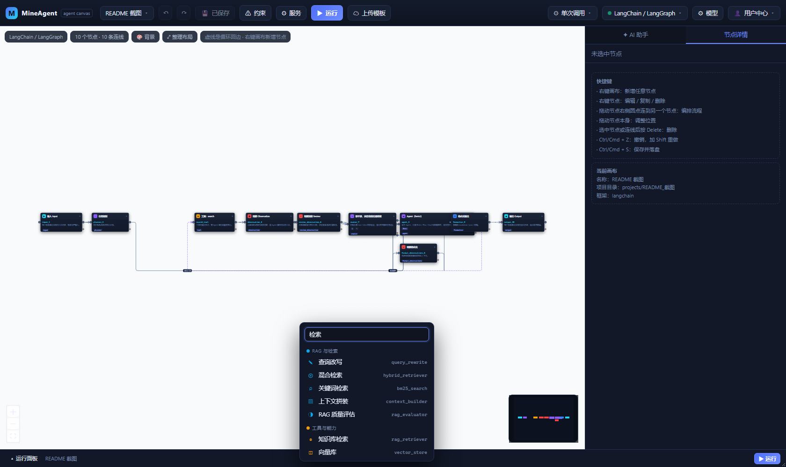

**RAG 全链路都是独立节点**，不是藏在某个"检索"黑盒里：

```text
索引侧：doc_loader → text_splitter → chunk_refiner → vector_indexer
查询侧：intent_recognizer → query_rewrite → query_expand → query_router
检索侧：hybrid_retriever（向量 + 关键词）→ reranker → context_builder → citation_formatter
质检侧：doc_grader → rag_evaluator
```

对应的 SDK 能力：`ctx.retrieve(mode="hybrid|vector|keyword")`、`ctx.vector_upsert/search`、
`ctx.rerank(query, docs, top_k)`、`ctx.build_context(docs, max_chars)`、`ctx.split_text()`、
`ctx.load_document()`（pdf/docx/md/csv）。

文档与多模态节点（`pdf_parser` / `ocr_extract` / `speech_to_text` / `image_analyzer`）依赖可选库，
没装时节点会返回一条可直接照做的安装提示，而不是把整个流程跑崩。

### 意图识别可以接 Jev（System One）

意图路由这类「模糊 if」交给生成式模型写 JSON 再解析，既贵又容易跑偏。可以换成
[Jev](https://docs.typesafe.ai/)（TypeSafe 的 System One 模型）——它不生成文本，
只回答选择题 / 判断题 / 打分题，直接返回带概率和 confidence 的结构化答案。

`intent_recognizer` 节点已经内置：

```python
resp = ctx.judge(
    {"message": ctx.text},
    {
        "intent": {"type": "choice", "instructions": "属于哪个意图？",
                   "criteria": {"咨询": None, "任务执行": None, "投诉": None}},
        "needs_tool": {"type": "noul", "instructions": "需要调外部工具吗？"},
        "effort": {"type": "score", "instructions": "处理量级",
                   "criteria": ["一句话", "几步", "要检索", "要拆多轮"]},
    },
)
# → {"answers": {"intent": {"choice": "投诉", "confidence": 0.93, "probabilities": {...}},
#                "needs_tool": {"noul": 0.88},
#                "effort": {"score": 2.1}}, "model": "jev-1.13.0", ...}
```

**启用方式**：

| 需要 | 设置 |
|---|---|
| API Key | 环境变量 `TYPESAFE_API_KEY`，或项目 `.env` 里写 `TYPESAFE_API_KEY=sk-...` |
| 自定义网关 | `JEV_ENDPOINT`（官方端点 `https://api.typesafe.ai/v1/systemone` 在部分地区返回 451，可指向兼容网关） |
| 模型版本 | `JEV_MODEL`（默认 `jev-latest`，建议线上钉 `jev-1.13.0`） |

**没配也能用**：`ctx.judge()` 在缺 key、401、429、451、连不上时抛 `JudgeUnavailable`，
节点会自动回退到普通模型判断（结果里 `engine` 字段标明是 `jev` 还是 `llm`）。
只有 422 这类「请求本身写错了」才会真的报错。

### LLM Wiki：入库时就理解，而不是查询时才拼

传统 RAG 是「查询时做功」——入库只切块存向量，用户提问的瞬间才开始算。
[LLM Wiki](https://m.leiphone.com/category/ai/Q24LRPqt1A6EUYiv.html)（Karpathy 的构想）反过来：
**入库时就读懂内容、提炼成互相链接的页面**，查询时直接读已经组织好的整页。

MineAgent 加了两个节点：

| 节点 | 做什么 |
|---|---|
| `wiki_ingest` | 把内容交给模型提炼标题、摘要、要点，写成一页 markdown 落到 `wiki/` |
| `wiki_query` | 列出 wiki 页，按字面重合粗排，命中不明确时让模型从候选里挑 |

存储就是**项目里的 `wiki/` 目录**，每页一个 `.md`，外加 `index.json` 记索引：

```
wiki/
  index.json                       # 标题、摘要、互链、更新时间
  订单退款政策.md                    # 页面正文（摘要 + 要点 + 原文）
```

好处是**可读、可编辑、可带走**——你可以直接打开 md 改内容，也可以用 git 管版本，
而不是像向量库那样只能靠工具读。SDK 侧对应 `ctx.wiki_ingest / wiki_query / wiki_pages / wiki_read`。

`agent.py` 里这两个节点也用纯 Python 实现（不 import runtime_sdk），
所以导出的项目即使删掉 SDK 也能跑。

### Super-agent：Router + Worker 双层

参考 [DeepSeek Super-agent](https://github.com/deepseek-ai/dsh-superagent-prototype) 的双层结构，
画布上新增了 `super_agent` 模式模板：

```
input → Router（主管）→ Worker A ┐
                      → Worker B ┴→ 汇总 → output
```

**Router 层**（`supervisor` 节点）会把任务并行派给多个 Worker：

```python
results = ctx.delegate_many(
    [(name, ctx.text) for name in ctx.subordinates],
    max_workers=4, timeout=180,
)
```

- 多个 worker 用线程池并行跑，互不阻塞
- **单个 worker 失败不会拖垮整体**——失败项会整理进最终提示，由 Router 决定重试还是降级
- 派发 / 完成都有事件（`delegate_start` / `delegate_done`），画布上能看到谁在跑

**能力边界（重要）**：

| 运行模式 | 并行派发 | 说明 |
|---|---|---|
| 零依赖预览（runner） | ✅ 完整支持 | `delegate_many` 真并行 |
| 原生运行（agent.py） | ⚠ 结构上并行 | LangGraph 会把 Router 的多个后继**并行执行**，但 Router 内部不做「拆任务 + 定向派发」，两个 Worker 拿到的是同一份输入 |

也就是说：**预览模式能验证完整的 Router/Worker 语义，原生模式目前表达的是
"并行分支 + 汇总"**。要做到原生模式也定向派发，需要 LangGraph 的 `Send` API
或 map-reduce 模式，属于后续工作。

常驻调度（Router 7×24 监听 IM / GitHub 事件、Watchdog 自恢复）属于**服务层**，
目前只在服务设置里预留了并发、超时、断点续跑等配置项，事件源接入还没做。

### 工具节点的预设（73 个）

拖一个 `tool` 节点进来，在「节点详情」里选预设，参数和代码会一起填好，不用自己写。
每个预设都有两份实现：`preview`（零依赖预览用）和 `native`（生成 `agent.py` 用）。

**网络与搜索（17）**

| 预设 | 作用 |
| --- | --- |
| `web_search` | 用 DuckDuckGo 搜索并返回前几条结果摘要（依赖 `ddgs`） |
| `http_get` | 抓取一个 URL 的文本（只读，超时 20 秒） |
| `http_post` | 向一个 URL POST JSON，返回响应文本 |
| `web_fetch` | 抓取一个 URL 的正文文本（前 8000 字） |
| `scrape_links` | 抓取页面并提取所有链接（含锚文本），可按关键词过滤 |
| `jina_reader` | 用 Jina Reader 把任意 URL 转成干净 Markdown（免费额度） |
| `wikipedia` | 查维基百科词条摘要（免费、无需 key） |
| `arxiv` | 按关键词搜 arXiv 论文，返回标题、作者、摘要和链接 |
| `pubmed` | 查 PubMed 医学文献摘要（NCBI 公共接口） |
| `rss_feed` | 读取 RSS / Atom 源的最新条目 |
| `github_api` | 查仓库 / issue / PR / 用户（有 token 可提高额度） |
| `dns_lookup` | 查域名的 A / AAAA / MX / TXT 记录 |
| `ip_info` | 查 IP 的国家、地区、ISP |
| `open_meteo` | 查城市当前天气与未来三天预报 |
| `webhook_send` | 向任意 Webhook 发消息（Slack / 飞书 / 钉钉 / Discord 通用） |
| `tavily_search` | Tavily 深度搜索，返回带来源的摘要（需 `TAVILY_API_KEY`） |
| `serper_search` | Serper.dev 的 Google 搜索结果（需 `SERPER_API_KEY`） |

**文件与目录（8）**

| 预设 | 作用 |
| --- | --- |
| `read_file` | 读取项目目录内的文本文件（默认 8000 字） |
| `read` | 按行读取项目内文本文件，支持 offset / limit |
| `write` | 把内容写入项目内的文件（自动建目录） |
| `edit` | 把文件里的 old 文本替换成 new（只替换第一处） |
| `glob` | 按 glob 模式列出项目内的文件 |
| `grep` | 用正则搜索项目内文件内容，返回路径、行号和命中行 |
| `working_directory` | 不带参数返回当前目录；带参数则切换过去 |
| `read_image` | 返回图片的文件大小与路径（不加载像素） |

**命令与代码（5）**

| 预设 | 作用 |
| --- | --- |
| `pwsh` | 在本机执行一条 PowerShell 命令 |
| `bash` | 在本机执行一条 shell 命令（Windows 走 cmd，其他走 bash） |
| `python_repl` | 在子进程里跑一段 Python，返回 stdout / stderr |
| `workflow` | 执行项目内 `workflows/<name>.py` 的 `run()` |
| `calculator` | 安全地计算四则运算表达式（不执行任意代码） |

**数据与文本处理（12）**

| 预设 | 作用 |
| --- | --- |
| `sql_query` | 对项目内的 SQLite 执行只读查询 |
| `csv_query` | 把 CSV 当表查：列筛选、排序、取前 N 行 |
| `json_query` | 从 JSON 文本里按 `a.b.0.c` 路径取值 |
| `regex_extract` | 用正则从文本里抽出所有匹配（可只取第 1 个分组） |
| `hash_text` | 算 md5 / sha1 / sha256，常用于校验与去重 |
| `base64_codec` | Base64 编码或解码（支持 URL-safe） |
| `uuid_gen` | 生成指定数量的 UUID4 |
| `diff_text` | 比较两段文本，输出逐行差异 |
| `markdown_to_html` | 把 Markdown 渲染成 HTML 片段 |
| `html_to_text` | 去掉标签、脚本和样式，只留可读正文 |
| `pdf_extract` | 从 PDF 里抽取文本（需 `pypdf`） |
| `docx_extract` | 从 `.docx` 里抽取段落文本（需 `python-docx`） |

**Office 文档（3）** — 都需要本机装 LibreOffice（`soffice`）

| 预设 | 作用 |
| --- | --- |
| `office_convert` | 用 LibreOffice 把文档转成 PDF |
| `office_render` | 用 LibreOffice 把文档渲染成 PNG |
| `office_recalculate` | 重算表格公式并另存 |

**知识与检索（2）**

| 预设 | 作用 |
| --- | --- |
| `knowledge_search` | 从项目 `skills/docs/outputs` 里召回片段（预览模式） |
| `skill` | 从项目 `skills/` 目录读取指定技能文件 |

**多 Agent 协作（5）**

| 预设 | 作用 |
| --- | --- |
| `subagent` | 用项目里的大模型独立跑一个子任务，返回结果 |
| `list_agents` | 从 `agent.json` 里读出画布上的 agent 节点 |
| `send_message` | 把消息追加到 `.agents/<name>.inbox.jsonl` |
| `wait_agent` | 轮询 `.agents/<name>.outbox.jsonl`，返回最后一条输出 |
| `interrupt_agent` | 写 `.agents/<name>.cancel` 标记，请求目标 agent 停止 |

**团队任务（4）** — 基于项目内 `.team.db`

| 预设 | 作用 |
| --- | --- |
| `team_task_create` | 插入一条任务，返回 id |
| `team_task_get` | 按 id 读取一条任务 |
| `team_task_list` | 列出任务，可按状态过滤 |
| `team_task_update` | 更新任务的状态或负责人 |

**目标与交付（5）**

| 预设 | 作用 |
| --- | --- |
| `todo_write` | 把待办列表写到项目根目录 `TODO.md` |
| `create_goal` | 把目标写进项目内 `.goal.json` |
| `get_goal` | 读取 `.goal.json` 的对象与状态 |
| `update_goal` | 更新目标状态并追加一条历史记录 |
| `present` | 把产物路径登记到 `.presented.json` |

**会话与调度（6）**

| 预设 | 作用 |
| --- | --- |
| `session_search` | 在项目内 `.sessions.jsonl` 里按关键词搜索 |
| `session_trace` | 按 `session_id` 取出一次会话的全部记录 |
| `schedule_create` | 把定时任务写进 `.schedules.json`（装 crontab 后生效） |
| `schedule_list` | 返回 `.schedules.json` 的内容 |
| `schedule_edit` | 修改指定定时任务的 cron 或命令 |
| `schedule_view` | 查看单个定时任务的配置 |

**交互与审批（2）**

| 预设 | 作用 |
| --- | --- |
| `ask_user_question` | 在命令行里向用户提问并返回回答；非交互环境返回提示 |
| `propose_action` | 把动作写进 `.actions.json` 等待审批 |

**其他（4）**

| 预设 | 作用 |
| --- | --- |
| `ralph` | 反复调用模型直到自评完成，返回最后一轮结果 |
| `current_time` | 返回服务器当前时间（ISO 格式） |
| `load_workspace_dependencies` | 返回 Python 解释器和 site-packages 路径 |
| `wolfram_alpha` | 数学 / 知识计算（需 `WOLFRAM_APP_ID`） |

### 主流编排架构画布

项目里预置了 14 张对照画布，把市面上的编排框架还原成节点图，可以直接打开做对比：

**开源**：LangGraph 状态图、CrewAI 角色流水线、CrewAI 层级模式、AutoGen 对话驱动、
MetaGPT 软件公司、Dify Chatflow、n8n 自动化流水线、Flowise 可视化 RAG、
Langflow 线性链、SmolAgents 代码行动

**闭源**：OpenAI Agent Builder、AWS Bedrock Agents、字节 Coze Bot、DeepSeek Super-agent

每张画布的节点都带真实可运行的实现，不是空壳：

| 节点 | 原生模式下的实现 |
|---|---|
| `critic` | 让模型按标准挑问题，返回评审意见 + 是否通过 |
| `self_check` | 逐条核对输出，返回问题清单和 ok 标志 |
| `merge` | 多路结果保序去重合并 |
| `intent_recognizer` | 结构化输出意图 + 置信度 |
| `doc_loader` | 真读 pdf/docx/md/csv；输入不是文件时按正文处理 |
| `text_splitter` | 按块大小和重叠切分 |
| `vector_indexer` | 写进项目内 SQLite 的 chunks 表 |
| `hybrid_retriever` | 从 chunks 表按相关度取回片段 |

生成脚本见 [tools/build_framework_blueprints.py](tools/build_framework_blueprints.py)，
批量运行与验证见 [tools/regen_and_run.py](tools/regen_and_run.py)。

| 分类 | 节点 |
| --- | --- |
| 输入输出 | `input` 输入、`output` 输出 |
| 推理与决策 | `llm` LLM 推理、`agent` Agent 主体、`prompt` 提示词模板、`system_prompt` 系统提示词、`planner` 任务规划、`decomposer` 任务分解、`router` 条件路由、`reflector` 反思、`critic` 评审、`self_check` 自检、`evaluator` 质量评估 |
| RAG 与检索 | `intent_recognizer` 意图识别、`slot_filler` 槽位抽取、`query_rewrite` 查询改写、`query_expand` 查询扩展、`query_router` 查询路由、`doc_loader` 文档加载、`text_splitter` 文本切分、`chunk_refiner` 分块精炼、`vector_indexer` 向量入库、`hybrid_retriever` 混合检索、`bm25_search` 关键词检索、`reranker` 重排、`context_builder` 上下文拼装、`citation_formatter` 引用标注、`doc_grader` 相关性打分、`rag_evaluator` RAG 质量评估 |
| 数据与存储 | `db_write` 数据写入、`kv_store` 键值存储、`cache_lookup` 缓存查询、`cache_write` 缓存写入、`graph_query` 图关系查询 |
| 文档与多模态 | `pdf_parser` PDF 解析、`table_parser` 表格解析、`ocr_extract` OCR 文字识别、`image_analyzer` 图像理解、`speech_to_text` 语音转写 |
| 文本加工 | `translator` 翻译、`classifier` 分类器、`extractor` 实体抽取、`sentiment` 情感分析、`fact_checker` 事实核查、`deduplicator` 去重、`merger` 多路合并、`outline_builder` 大纲生成、`section_writer` 分段写作、`polisher` 润色、`title_generator` 标题生成 |
| 工具与能力 | `tool` 工具、`function` 自定义函数、`http_request` HTTP 请求、`web_search` 联网搜索、`code_interpreter` 代码解释器、`shell` 命令执行、`file_io` 文件读写、`sql_query` SQL 查询、`rag_retriever` 知识库检索、`embedding` 向量化、`vector_store` 向量库、`mcp_tool` MCP 工具、`browser` 网页抓取、`skill` 技能 |
| 记忆与状态 | `memory` 记忆、`state_store` 状态存取、`blackboard` 黑板、`history` 会话历史 |
| 流程控制 | `condition` 条件判断、`loop` 循环控制、`join` 分支汇聚、`delay` 延时、`subgraph` 子图调用、`human_approval` 人工审批、`guardrail` 护栏、`rate_limiter` 限流、`circuit_breaker` 熔断、`budget_guard` 预算控制、`cost_tracker` 成本统计 |
| 观察与反馈 | `observation` 观察、`review_observation` 观察复核、`format_observations` 观察格式化、`error_handler` 错误处理、`retry` 重试、`fallback` 兜底 |
| 多智能体协作 | `supervisor` 主管、`worker` 工作者、`group_chat` 群聊、`handoff` 转交、`debate` 辩论、`message_bus` 消息总线 |
| 后处理与交付 | `formatter` 格式化、`parser` 结构化解析、`summarizer` 摘要、`validator` 结构校验、`artifact_writer` 产物写出、`notification` 通知推送、`json_repair` JSON 修复、`markdown_render` Markdown 渲染 |
| 框架专有 | `langgraph_state` / `langgraph_node` / `langgraph_edge`、`autogen_assistant` / `autogen_user_proxy` / `autogen_group_chat` / `autogen_tool_agent`、`crewai_agent` / `crewai_task` / `crewai_crew` / `crewai_tool` |

每个节点在画布上都是独立可编辑的方块，点开就能改它的代码——没有藏在框架内部的"黑盒步骤"。

新增节点类型只需要在 `backend/app/node_registry.py` 的 `_DEFS` 里加一行，
并在 `node_templates.py`（或 `node_templates_ext.py`）里写默认代码，前端菜单会自动出现。

---

## 支持的框架
| 框架 | 状态 | 说明 |
| --- | --- | --- |
| LangChain / LangGraph | ✅ 可运行 | 画布 1:1 映射为 `StateGraph`，条件边对应多端口节点 |
| AutoGen | ✅ 可运行 | 节点映射为 `AssistantAgent` + `RoundRobinGroupChat` |
| CrewAI | ✅ 可运行 | 节点映射为 `Agent` / `Task` / `Crew` |
| MetaGPT、Agno、SmolAgents、Semantic Kernel、OpenAI Agents SDK、Dify Workflow | 🎨 架构图 | 选中后生成对应风格的架构图与代码骨架，暂不接原生执行 |
| Harness（零依赖） | ✅ 可运行 | 不套任何框架：`agent.py` 就是项目自带的图执行器，直接读 `agent.json` 跑节点，工具/压缩/持久化由 `runtime_sdk` 提供。适合表达自研 runtime |

### 各框架支持的推理 / 协作模式

顶部「选择模式」下拉会按当前框架列出可选模式，33 个模式按框架的能力挑配：

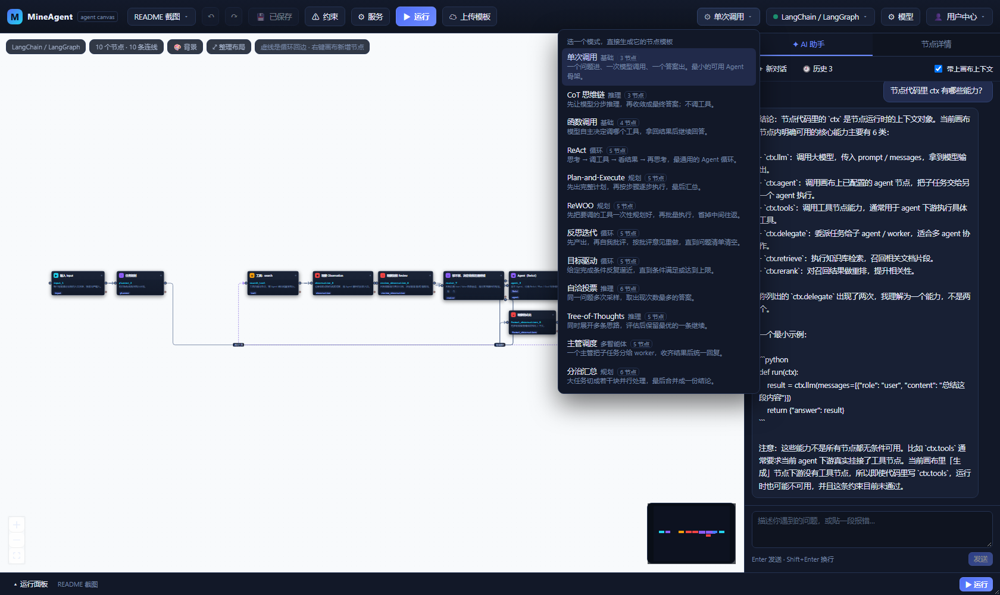

| 框架 | 模式（个数） |
| --- | --- |
| LangChain / LangGraph | 单次调用、CoT、函数调用、ReAct、Plan-and-Execute、ReWOO、反思、目标驱动、自洽投票、Tree-of-Thoughts、主管调度、分治汇总（12） |
| AutoGen | 单次调用、函数调用、双人对话、群聊、顺序接力、嵌套对话、辩论、反思、代码行动、移交、群体交接、护栏校验（12） |
| CrewAI | 单次调用、顺序接力、层级分派、并行处理、共识投票、辩论、分治汇总（7） |
| MetaGPT | 标准作业流程、顺序接力、辩论、Plan-and-Execute、反思（5） |
| Agno | 单次调用、函数调用、ReAct、显式推理、意图路由、主管调度、并行、节点工作流、护栏校验（9） |
| SmolAgents | 代码行动、函数调用、ReAct、受管执行、Plan-and-Execute（5） |
| Semantic Kernel | 单次调用、函数调用、Plan-and-Execute、群聊、移交、意图路由（6） |
| OpenAI Agents SDK | 单次调用、函数调用、移交、护栏校验、结构化输出、主管调度、并行（7） |
| Dify | 对话流、节点工作流、函数调用、CoT、检索增强（5） |
| 自定义 | 单次调用、CoT、函数调用、ReAct、Plan-and-Execute、目标驱动、反思、顺序接力、层级分派、辩论、移交（11） |

模式分五组：基础 / 推理 / 循环 / 规划 / 多智能体 / 框架专有，下拉里会标出来。

### 每个模式自带节点模板

**选中模式会直接生成对应的画布**，不是只改一个设置值——33 个模式各有一套最小可用架构，
从 3 节点（单次调用）到 6 节点（自洽投票、分治汇总、代码行动）。生成后 `Ctrl+Z` 可撤销。

| 模式 | 生成的节点链 |
| --- | --- |
| 单次调用 | input → llm → output |
| CoT 思维链 | input → llm（分步推理） → output |
| 函数调用 | input → agent(tool_call) → tool → output |
| 结构化输出 | input → llm(只输出 JSON) → formatter → output |
| Self-Ask | input → 拆子问题 → 逐题回答 → 汇总 → output |
| 自洽投票 | input → 采样 A/B/C → 投票汇总 → output |
| Tree-of-Thoughts | input → 展开思路 → 评估打分 → 求解 → output |
| **ReAct** | input → agent(react) → tool → 观察 → 回到 agent → output |
| 目标驱动 | input → agent(goal) → 完成度判断 → 达标?（否→回到 agent / 是→output） |
| 反思迭代 | input → 生成 → 评审 → 还要改?（是→回到生成 / 否→output） |
| Plan-and-Execute | input → 任务规划 → 按计划执行 → 整理结果 → output |
| ReWOO | input → 规划工具序列 → 批量执行 → 融合结果 → output |
| 分治汇总 | input → 切分任务 → 分片 A/B → 合并 → output |
| 主管调度 | input → 主管 → worker → 汇总 → output |
| 群聊 | input → 群聊 → 参与者 → 收敛结论 → output |
| 顺序接力 | input → 第一棒 → 第二棒 → 第三棒 → output |
| 层级分派 | input → 管理者 → 执行者 → 验收 → 回到管理者 → output |
| 并行处理 | input → 拆分支 → 分支 A/B → 合并 → output |
| 辩论 | input → 正方/反方 → 裁判 → output |
| 共识投票 | input → 成员 A/B → 投票定案 → output |
| 嵌套对话 | input → 主 Agent → 子 Agent → 整合 → output |
| 移交 | input → 前台 Agent → 该谁处理?（是→专职 Agent / 否→output） |
| 群体交接 | input → Agent A → Agent B → Agent C → output |
| 意图路由 | input → 意图识别（true→咨询 / false→执行） → output |
| 双人对话 | input → Assistant ↔ 代理用户 → 收敛 → output |
| 代码行动 | input → agent → 代码安全检查 → 代码执行 → 观察 → 回到 agent → output |
| 标准作业流程 | input → 分析师 → 执行者 → 复核 → output |
| 护栏校验 | input → 输入校验（不过→output） → Agent → 输出校验 → output |
| 节点工作流 | input → 处理 1 → 处理 2 → 输出整理 → output |
| 对话流 | input → 会话记忆 → 回答 → output |
| 受管执行 | input → 管理 Agent → 受管 Agent → 收口 → output |
| 显式推理 | input → 推理步骤 → 检查推理 → 整理 → output |
| 检索增强 | input → 检索 → 基于资料回答 → 附上引用 → output |

33 个模板全部通过编排约束检查（0 error / 0 warn）。

三个「可运行」框架的项目都会生成 `agent.py` 原生入口；
如果本机没装该框架，`agent.py` 会自动提示并回退到内置 `runner.py`，保证流程任何时候都能跑。

装框架依赖：

```powershell
.\.venv\Scripts\python.exe -m pip install -r "projects\你的画布\requirements.txt"
```

---

## 配置模型

四种方式，优先级从高到低：

1. **节点级**：右键 agent 节点 →「配置模型 / API Key」（只影响这个 agent）；
2. **画布级**：右上角「画布配置」→ 对话模型页签里填 Base URL / 模型名 / API Key（只影响这个画布）；
3. **全局**：右上角「用户中心 → 模型配置」→ 配置整个项目默认使用的 key（兜底）；
4. **项目文件**：在 `projects/<画布>/.env` 里写 `MINEAGENT_API_KEY=sk-xxx`（脱离网页独立运行时用）。

填好可点「测试连接」立即验证。Key 加密存在本机 `backend/data/mineagent.db`，
接口只回显 `sk-****abcd` 形式的掩码，不返回明文。
节点级的 key 存在 `agent_models` 表，运行时只以 `MINEAGENT_KEY_<节点ID>` 环境变量的形式注入子进程。

**模型名不用手敲**：填完 Base URL 和 API Key 后，点输入框右边的「⟳ 获取列表」，
会调服务商的 `/v1/models` 把可用模型拉下来填进下拉候选（三处配置都支持：模型配置 / 画布模型 / 节点模型）。
如果服务商不提供这个接口，会提示你直接手填，输入框始终可以自由输入。

常见服务商的 Base URL 内置在预设里（**DeepSeek 是默认**、OpenAI、通义千问、智谱、月之暗面、Ollama 本地、自定义兼容地址）。

---

## 向量模型 / 向量库 / 数据源

这些是**画布级**配置：入口在右上角「画布配置」→ 弹窗里的三个页签
（**向量模型**、**向量库**、**数据源**），和对话模型并列。

同一张画布可以配**多套**：比如一个本地 bge-m3 建库、一个云端模型做查询，
或者一个 Chroma 存文档、一个 pgvector 存订单。每种类型有一个「默认」，
节点属性里可以单独改成用哪一套：

```
节点参数「向量库」= 跟随画布默认 / 本地库 / 订单库
```

不配也能跑：`embedding` / `vector_indexer` / `vector_store` / `hybrid_retriever`
会回退到内置 SQLite 与哈希向量。

### 内置清单

| 类别 | 数量 | 覆盖 |
| --- | --- | --- |
| 向量模型 | 38 家 / 350+ 模型 | OpenAI、Azure、通义、智谱、硅基流动、火山、混元、千帆、百川、MiniMax、Cohere、Jina、Voyage、Gemini、Mistral、Together、Fireworks、DeepInfra、Nebius、Nomic、Mixedbread、Upstage、Snowflake、Vertex、Bedrock，以及 Ollama / TEI / vLLM / LM Studio / Xinference / LocalAI / FastChat，和 FastEmbed / sentence-transformers 进程内直跑 |
| 向量库 | 46 个（全部已实现） | 内置 SQLite、sqlite-vec、Chroma、pgvector / pgvecto.rs / GaussDB、Qdrant、Milvus/Zilliz、Weaviate、LanceDB、FAISS、Elasticsearch、OpenSearch、Redis、Pinecone、DuckDB VSS、ClickHouse、Typesense、Upstash、Turbopuffer、Azure AI Search、ArangoDB、Vectara、Vespa、SurrealDB、Couchbase、Oracle、SAP HANA、Vertex AI、MySQL 家族（MariaDB/TiDB/OceanBase/Doris/StarRocks/SingleStore）、MongoDB Atlas、DashVector、腾讯云 VectorDB、百度向量数据库、VikingDB |
| 数据源 | 48 个（全部已实现） | 关系型：PostgreSQL / MySQL / MariaDB / SQL Server / Oracle / SQLite / ClickHouse / DuckDB / TiDB / OceanBase / GaussDB / PolarDB / Greenplum / Redshift / Snowflake / BigQuery / Databricks / Trino / Presto / Hive；文档型：MongoDB / DocumentDB / Couchbase / Firestore / ArangoDB / CouchDB；图：Neo4j / Memgraph / NebulaGraph / TigerGraph / JanusGraph / Dgraph / Apache AGE / HugeGraph / TuGraph；KV：Redis / Valkey / Memcached / etcd / DynamoDB / Cassandra / ScyllaDB / HBase；时序：InfluxDB / TimescaleDB / TDengine / Prometheus / QuestDB |

未实现的条目在下拉里禁用并标「即将支持」，不会让你配完才发现跑不起来。

### 三个约定

**1. 配置跟着画布走。** 每张画布有自己的实例清单，互不影响；同一类型里
「设为默认」的那个会被节点默认使用，节点参数留空就跟随它。
老版本存在全局作用域里的记录仍可读取，但新建的一律属于当前画布。

**2. 密钥加密落库，只走环境变量。** 密钥字段单独加密存在 `providers` 表，
接口只回显 `sk-****abcd`；生成项目时 `config.json` 里只有 `api_key_env` 的名字
（第一个实例是 `MINEAGENT_EMB_KEY`，之后是 `_2`、`_3`，向量库 / 数据源同理），
值由运行时通过环境变量注入子进程，**不会写进任何项目文件**。

**3. 依赖是懒加载的。** 没装 `chromadb` 时选不了 Chroma 的节点不会把流程跑崩，
而是返回一条可照做的提示：`需要 chromadb → 运行 pip install chromadb`。
主 `requirements.txt` 仍然只有框架本身那几个包。

### 节点里怎么用

```python
ctx.embed(text)                        # 单条文本 → 向量（走配置的向量模型）
ctx.embed_many(texts)                  # 批量
ctx.vector_upsert(text, metadata={})   # 写入配置的向量库
ctx.vector_search(query, top_k=4, where={"source": "faq"})
ctx.use_collection("another")          # 临时换集合
ctx.query_data("SELECT * FROM orders") # 读数据源（SQL / Cypher / Redis 命令）
ctx.write_data("INSERT INTO ...")      # 写数据源
```

节点代码里不需要区分底层是 Chroma 还是 Qdrant——切换库只改配置，代码不用动。

### 换模型必须重建索引

不同 embedding 模型的向量维度不同，混用会得到毫无意义的相似度。
所以集合会记下首次入库时的维度与模型指纹，**维度不一致直接报错**并提示重建，
而不是静默返回垃圾结果。

```python
# 换模型后的正确做法
ctx.vector_store_drop("docs")   # 清空旧集合
# 再用新模型重新跑一遍 vector_indexer
```

### 导出的项目怎么连

`providers/` 目录会跟着 `runtime_sdk.py` 一起复制进 `projects/<画布>/`，
所以导出的项目脱离平台也能连自己的向量库：

```bash
# 1) 装你用的那个库
pip install qdrant-client

# 2) 在 .env 里填密钥（网页上配过的话可以跳过）
MINEAGENT_VEC_KEY=your-token

# 3) config.json 里已经有连接配置了，直接跑
python runner.py --input "你的问题"
```

---

## 节点代码能用到什么

节点代码有两种写法，取决于当前跑的是哪条路径：

- **预览（零依赖，`runner.py`）**：节点是 `run(ctx)` 函数，下面这些能力都由 `ctx` 提供
- **原生（`agent.py`）**：节点是 `def xxx(state: AgentState) -> dict`，直接用框架自己的 API

`ctx` 提供：

```python
ctx.text / ctx.input        # 上游输出（字符串 / 原始对象）
ctx.state                   # 跨节点共享的可变字典
ctx.params                  # 节点面板里配置的参数
ctx.llm(prompt, system=)    # 调大模型
ctx.llm_stream(...)         # 流式调大模型（token 会实时推到画布）
ctx.agent(task, tools, mode=)  # 内置 agent，mode 可选 react/plan_execute/goal/reflexion/tool_call/simple
ctx.judge(state, questions) # 交给 Jev 做结构化判断（choice / noul / score），没配 key 会抛 JudgeUnavailable
ctx.superior                # 我的上级 agent 名字
ctx.subordinates            # 下级 agent 名字列表
ctx.peers                   # 平级 agent 名字列表
ctx.delegate(名字, 任务)     # 把任务派给某个 agent 并取回结果
ctx.delegate_many([...])    # 并行派给多个 agent，单点失败不影响其它
ctx.json_prompt(...)        # 结构化输出
ctx.http(...) / ctx.search() / ctx.fetch_text() / ctx.mcp_call(...)
ctx.skill(name, inline)     # 读 skills/*.md 或直接用内联的 skill.md 内容
ctx.remember() / ctx.recall() / ctx.history()
ctx.retrieve() / ctx.embed() / ctx.vector_upsert() / ctx.vector_search()
ctx.embed_many() / ctx.use_collection() / ctx.vector_delete() / ctx.vector_store_drop()
ctx.wiki_ingest() / ctx.wiki_query() / ctx.wiki_pages() / ctx.wiki_read()   # LLM Wiki
ctx.query_data() / ctx.write_data() / ctx.data_tables()   # 数据源（SQL / Cypher / Redis）
ctx.exec_python() / ctx.shell() / ctx.read_file() / ctx.write_file() / ctx.query_sql()
ctx.log() / ctx.emit() / ctx.route()
```

`skill` 节点既可以直接把整份 `skill.md` 粘进代码，也可以在参数里填文件名，
再用 `ctx.skill()` 读取 `skills/` 下的文件。

---

## 测试

```powershell
# 后端 + 代码生成 + 真实执行（需要 mock 或真 key）
.\.venv\Scripts\python.exe tools\smoke_test.py

# 框架切换 / 改名 / 删除 / 文件浏览
.\.venv\Scripts\python.exe tools\api_test.py

# 编排约束：内置规则 / 自定义规则 / 运行拦截
.\.venv\Scripts\python.exe tools\constraint_test.py

# Agent 模式 / 多 agent 委派 / 节点级模型
.\.venv\Scripts\python.exe tools\feature_test.py

# 节点库与细粒度能力（113 节点、检索链路、新 SDK 能力）
.\.venv\Scripts\python.exe tools\granularity_test.py

# 浏览器端交互（右键菜单、代码编辑、保存、运行）
cd frontend
node test/ui-smoke.mjs
```

---

## 常见问题

**端口被占用**：`.\start.ps1 -Port 8080`。

**前端改了代码没生效**：`.\start.ps1 -Rebuild`，或 `cd frontend; npm run build`。

**中文在脚本里显示乱码**：`start.ps1` 已存为 UTF-8 with BOM；如果被编辑器改存成别的编码，
用 PowerShell 7 运行，或重新执行 `.\start.ps1 -NoBrowser` 检查提示信息。

**运行报「缺少模型 API Key」**：按上面「配置模型」任选一种方式配置。

**模型返回 401/404**：检查 Base URL 是否带 `/v1`（如 `https://api.deepseek.com/v1`），
以及模型名是否与服务商一致。

**想彻底重来**：删掉 `backend/data/` 和 `projects/` 下的内容，重新启动即可
（会生成新的加密主密钥，已保存的 key 需要重填）。

**网页上改了代码，但项目目录里被我手改过**：以画布为准——点保存会重新生成
`agent.py`，把画布里的代码块写回去。想保留项目目录里的手改，先在网页上把那一段
改过来，或者把节点标记为「已手改」（保存时不会覆盖你的版本）。
建议始终在网页里编辑节点代码，或者改完不要再到网页点保存。

---

## License

Copyright 2026 YT-Proteus-bot

Licensed under the Apache License, Version 2.0 (the "License");
you may not use this file except in compliance with the License.
You may obtain a copy of the License at

    http://www.apache.org/licenses/LICENSE-2.0

Unless required by applicable law or agreed to in writing, software
distributed under the License is distributed on an "AS IS" BASIS,
WITHOUT WARRANTIES OR CONDITIONS OF ANY KIND, either express or implied.
See the License for the specific language governing permissions and
limitations under the License.

### 关于出处

本项目采用 Apache-2.0，允许商用、允许闭源分发，只需保留版权声明与 NOTICE。
如果你愿意在文档或产品页里注明一句「基于 MineAgent 构建」，非常欢迎——
但这是请求，不是许可条件，不注明也不构成违约。
